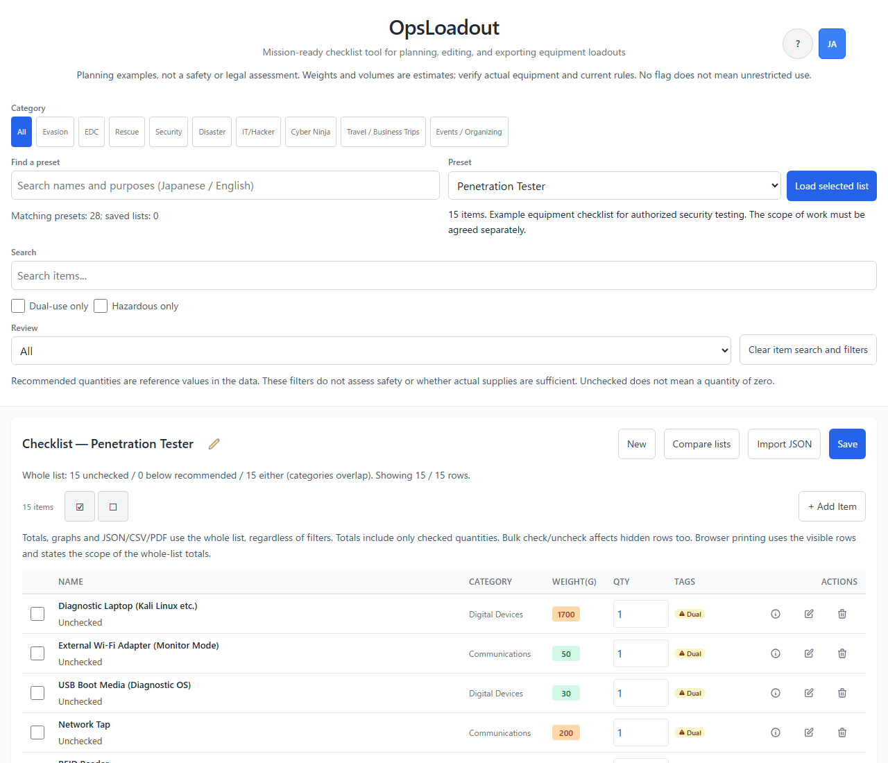
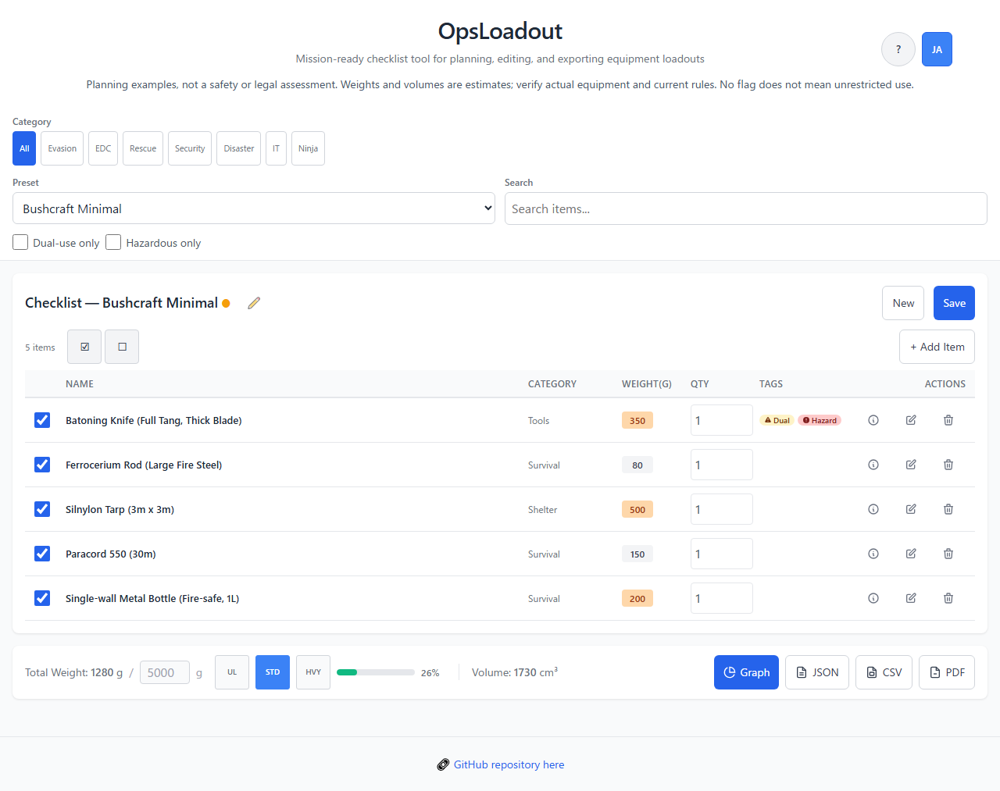
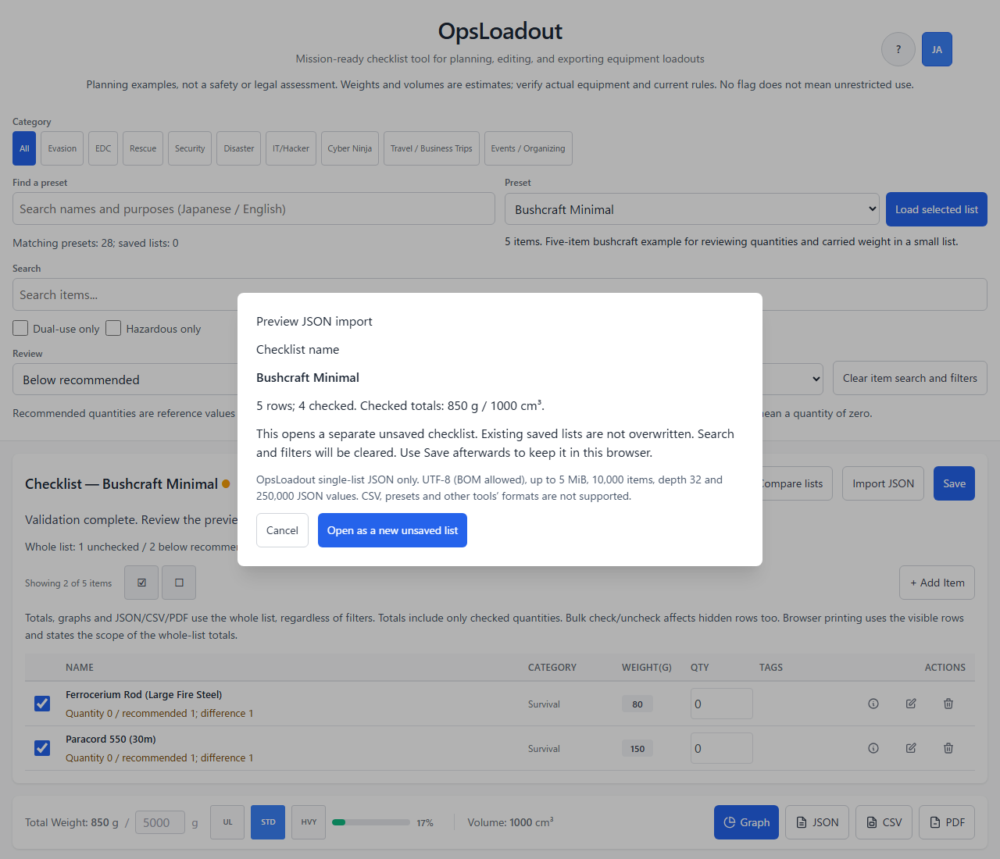

<!--
---
id: day098
slug: ops-loadout

title: "OpsLoadout"

subtitle_ja: "緊急脱出キットのチェックリストツール"
subtitle_en: "Operations Packing Checklist Tool"

description_ja: "装備構成（Loadout）を計画・編集・確認・出力するチェックリストツール。数量とチェック状態から重量・体積を集計し、軍民両用・危険物フラグ、出典、国別の注意を記録します。28種類のプリセットを収録。安全性・合法性や必要物資の充足は判定しません。"
description_en: "A checklist tool for planning, editing, reviewing, and exporting equipment loadouts. Calculates weight and volume from quantities and checked items, and records dual-use/hazard flags, sources, and country-specific notes. Includes 28 presets. Does not determine safety, legality, or whether supplies are sufficient."

category_ja:
  - 物理的セキュリティ
  - サイバー忍術
  - スパイ
  - プレッパー
category_en:
  - Physical Security
  - Cyber Ninjutsu
  - Spy
  - Prepper

difficulty: 3

tags:
  - ops
  - loadout
  - kit-management
  - inventory
  - tactical
  - fieldcraft
  - packlist
  - javascript
  - sere
  - edc
  - disaster-preparedness

repo_url: "https://github.com/ipusiron/ops-loadout"
demo_url: "https://ipusiron.github.io/ops-loadout/"

hub: true
---
-->

# OpsLoadout - Emergency Kit Checklist Tool

English · [日本語](README.md)


[](https://ipusiron.github.io/ops-loadout/)

**Day098 - 100 Security Tools Built with Generative AI**

OpsLoadout is a tool for planning, editing, reviewing, and exporting an equipment configuration (loadout) for a particular operation.

It is intended for professional and training uses, including military and law-enforcement organizations, SERE education, and organizational stockpiling and preparedness.
It manages the current state of what to carry and what has been checked. It does not implement staff assignments, change history, audit trails, or synchronization across devices.

Each item can have a dual_use flag, a hazard_flag, source links, and country-specific legal notes (legality_notes).
These are notes for review. The tool does not determine equipment safety or legality, whether evacuation is possible, or whether supplies are sufficient. Check official local guidance, your organization's procedures, and the conditions for using each product separately.

---

## 🌐 Demo

👉 [https://ipusiron.github.io/ops-loadout/](https://ipusiron.github.io/ops-loadout/)

You can use the tool directly in your browser. The button at the top right switches between Japanese and English. The initial language is English if the saved preference is English; otherwise, it is Japanese.

---

## 📸 Screenshots

>
>
>*The Pentester list, with the JSON import and review controls visible.*

>
>
>*A Bushcraft Minimal input example. The fire steel and paracord have quantity 0, and the bottle is unchecked. The “Below recommended” filter shows 2 items. Checked totals for the whole list are 850 g and 1000 cm³.*

>
>
>*Import preview of JSON exported from the state above: 5 items, 4 checked (including 2 with quantity 0), 850 g, and 1000 cm³.*

---

## 🎯 Main Design Principles

- Record sources: Display book titles, document names, and URLs from the presets, without guaranteeing that the entries match the source text or that the information is current
- Support education and preparation: Help review equipment lists, without providing procedures for dangerous activities or illegal acts
- Distinguish cautions: Display indicators for `dual_use` and `hazard_flag` and refer to the country-specific notes entered in the data
- State source limitations: The 28 presets contain 398 item entries with source titles; 7 have URL-bearing sources and 391 do not. The entries have not all been checked against their source texts

---

## 👥 Target Users

The tool is intended for individuals and organizations such as the following:

### Companies and Organizations

- Safety departments and business continuity management (BCM) staff: Kit inventories and equipment reviews for employees based overseas
- Security companies and security departments: Guard equipment inventories and periodic inspection checklists
- Fire departments and rescue teams: Carried-equipment management and training checklists for firefighters and rescuers
- IT companies and security teams: Professional equipment management for pentesters, network engineers, and forensic investigators
- Mountain rescue and search-and-rescue (SAR) teams: Equipment checks and mission-specific packing lists
- SERE training facilities and educational institutions: Survival training curricula and equipment teaching materials
- Disaster-preparedness staff in local authorities and businesses: Staff emergency-kit distribution and evacuation-drill materials

### Individuals and Families

- Disaster-conscious individuals and families: Emergency evacuation kits for earthquakes, typhoons, and other disasters
- Remote workers with multiple bases: Kits kept at home, their parents' home, shared offices, and other locations
- Overseas employees and travelers: Go bags for emergencies abroad
- Outdoor enthusiasts and hikers: Equipment checklists for day hikes and longer treks
- Preppers: Systematic management of equipment for longer-term, self-sufficient survival planning

### Professionals and Technicians

- Digital nomads and IT professionals: Business-continuity equipment for international travel, including computers, communications devices, and power accessories
- Locksmiths: Professional tool inventories and equipment checks for service visits
- Hardware developers working on IoT and embedded systems: Measuring instruments and tool kits for on-site debugging
- System administrators: Tool kits for data-center and server-room maintenance
- Radio communications technicians: Carried radio equipment and measuring instruments, with attention to applicable radio regulations

---

## ✨ Main Features

### 1. Preset Management

- Built-in presets: 28 scenario-based presets
  - Evasion/escape: Embassy Escape, SERE
  - Everyday carry: Urban Personal
  - Rescue/fire: Firefighter, SAR
  - Security: Security Guard, Locksmith
  - Disaster preparedness: Disaster, Prepper, Bushcraft (Minimal/Standard/Extended), Matagi
  - Hacker/IT: Digital Nomad, Pentester, Network Engineer, Digital Forensics, Hardware Developer, SysAdmin, Data Recovery, RF Tech
  - Cyber ninja: Daphnia Style
- Saved checklists: Store and reuse lists in the browser with localStorage
  - Rename: Edit the name of the selected saved checklist
  - Delete: Confirm and delete an unwanted saved checklist
- Category filters: Narrow the preset choices by 9 categories: evasion, everyday carry, rescue, security, disaster, IT, cyber ninja, travel/business trips, and events/organizing

### 2. Checklist Management

- Multiple saved checklists: Load or delete entries from the saved-checklist list
- Overwrite/save as new: Choose whether to overwrite an existing checklist or save a separate copy
- Item operations: Add, edit, delete, and view details
- Search and filters: Search item names and purposes in the display language, combined with dual-use, hazard, and review conditions

When a save is rejected, the tool retains unsaved edits and does not report success. It does not automatically overwrite corrupted saved data. Comparisons immediately before saving detect updates from another tab, but do not guarantee complete protection against concurrent editing.

### 3. Packing Features

- Quantity management: Edit integers from 0 to 999 directly in a row; zero remains zero
- Recommended quantity: Record `recommended_quantity` as a reference value and identify rows with a smaller current quantity; this does not determine actual needs or whether supplies are sufficient
- Repack frequency: Record daily / weekly / monthly / never, without notifications or replacement-date calculations
- Checkboxes: Mark items as packed
- Automatic totals: Multiply each checked item's per-unit weight and volume by its quantity, then sum the results; unchecked items are excluded

### 4. Item Details

- Sources and legal notes (`sources`, `legality_notes`)
- Weight, volume, quantity, recommended quantity, repack frequency, and category tags
- Warnings for dual-use and hazard flags

### 5. Export Features

- PDF: Render the list, including Japanese text, as an image with checked states, quantities, tags, and totals; the text is not searchable or selectable
- CSV: Export every item in 12 fixed columns, with a UTF-8 BOM, CRLF line endings, quoted cells, and protection for leading characters commonly interpreted as formulas
- JSON: Export the current checklist name, export timestamp, and every item; use “Import JSON” to preview and restore the file

The CSV column order is `id,name,category,weight_g,volume_cm3,purpose_short,dual_use,hazard_flag,legality_notes,quantity,recommended_quantity,checked`. Formula protection does not guarantee safety in every spreadsheet application. When importing data from outside sources, also check settings that treat cells as text.

JSON, CSV, and PDF include every item regardless of filters. On-screen totals and graphs also use checked quantities from the whole list. Only browser printing prints the displayed rows, accompanied by the displayed count, filter conditions, and a note that totals are calculated from the whole list. To print every row, select “Clear item search and filters.”

### 6. Graph Views

- Three views: Switch between a pie chart, a radar chart, and a top-items list using tabs
- Shared statistics: Each view shows checked items with a positive quantity, along with their total weight and volume
- Image download: Download the current graph as a PNG
- Image copy: Copy the PNG to the clipboard in supported browsers; use PNG download when copying is unavailable

The radar chart uses simple averages of the 0–5 reference scores stored in the data. It does not weight scores by quantity, excludes missing values, and displays 0 when no values are available. It also displays `legality_penalty` without inverting it. These values are not measurements or certifications of survivability, legality, or safety.

### 7. Language Support (i18n)

- Japanese/English switching: Change the language immediately using the button at the top right
- Saved preference: Store the selected language in localStorage; when storage is unavailable, apply it only to the open page
- Display language: Switch the UI and translated preset fields; user-entered text and checklist names are not automatically translated

When a translated preset field is edited, its changed value becomes shared by both languages. Unchanged translations and metadata not shown in the form are retained. Switching the language alone does not load a different checklist over the current edits.

### 8. Target-Weight Presets

- UL (Ultralight): Set the weight target to 3,000 g
- STD (Standard): Set the weight target to 5,000 g
- HVY (Heavy): Set the weight target to 10,000 g
- Manual setting: Set an integer target from 100 to 1,000,000,000 g

These are targets for the progress display, not the actual weights of presets or weights that can be carried safely. For the totals calculated from the three Bushcraft presets, see the table under “Example Presets.”

### 9. Lazy Preset Loading

- On-demand loading: Fetch preset JSON when selected over HTTP(S)
- Cache management: Keep loaded presets in memory
- Local-file support: Load the generated `presets-bundle.js` under `file://`; fetching the PDF libraries requires a network connection

### 10. Restoring a JSON Backup

1. Export the current list with “JSON” and check that the file was saved.
2. Select the file with “Import JSON” and review the name, total item count, checked-item count, weight, and volume in the preview.
3. Select “Open as a new unsaved list.” If there are unsaved edits, replacement occurs only after you confirm that they can be discarded.
4. Review the contents and select “Save.” The list is added with a new saved ID; an existing saved list with the same name is not automatically overwritten.

Importing alone does not write to localStorage. Cancellation or an invalid file preserves the current list and saved data. If an edit or another load occurs while a file is being read, the stale result is not applied. If saving fails, the imported contents remain available as unsaved edits.

The accepted format is a single JSON object with `checklistName` and `items`, matching OpsLoadout's export. This format example includes zero quantity, an unchecked state, translations, and additional metadata.

```json
{
  "checklistName": "Restore example",
  "createdAt": "2026-10-12T00:00:00.000Z",
  "items": [
    {
      "id": "restore_sample",
      "name_ja": "見本",
      "name_en": "Sample",
      "weight_g": 50,
      "volume_cm3": 20,
      "quantity": 0,
      "recommended_quantity": 2,
      "checked": false,
      "packed_by_default": true,
      "custom_meta": {"note": "keep"}
    }
  ]
}
```

Explicit zero and false values, unchanged translations, and additional item metadata are retained. Missing fields receive the defaults described in the data model. `createdAt` is an optional string and is not carried over as the new saved timestamp. Additional root-level information is inspected but is not added to the saved list. Raw preset JSON, arrays of saved lists, CSV, and JSON from other Day tools cannot be imported directly.

| Validation target | Limit |
|---|---:|
| UTF-8 file size in bytes | 5 MiB (5,242,880 bytes) |
| JSON depth (root at 0) | 32 |
| JSON nodes (root and each object, array, or value) | 250,000 |
| Item count | 10,000 |

One leading UTF-8 BOM is allowed and counts toward file size. Invalid UTF-8, syntax, types, numeric ranges, and duplicate IDs are rejected, as are `__proto__`, `constructor`, and `prototype` keys and non-finite values anywhere in the JSON. Depth includes primitive leaf values, and unused additional information is also subject to the depth and node limits. Staying within these limits does not guarantee storage capacity or comfortable performance.

### 11. Reviewing Unchecked Items and Quantities Below the Recommendation

“Review” offers “All,” “Unchecked,” “Below recommended,” and “Either condition.” “Either condition” includes rows that are unchecked or below their recommended quantity. These conditions are combined with search, dual-use, and hazard filters using AND. “Clear item search and filters” clears these conditions but does not change the preset category above them.

Unchecked means `checked === false`; below recommended means `quantity < recommended_quantity`. An unchecked item is not treated as having zero quantity. The difference is `max(0, recommended_quantity - quantity)`. In the examples below, true means a condition matches and false means it does not.

| ID | checked | quantity | recommended_quantity | Unchecked | Below recommended | Difference | Either |
|---|---|---:|---:|---|---|---:|---|
| A | false | 0 | 0 | true | false | 0 | true |
| B | true | 0 | 2 | false | true | 2 | true |
| C | false | 1 | 3 | true | true | 2 | true |
| D | true | 3 | 3 | false | false | 0 | false |
| E | false | 4 | 3 | true | false | 0 | true |

These 5 rows contain 3 unchecked items, 2 below their recommended quantity, and 4 matching either condition. C matches both but is not counted twice under “Either.” The displayed condition counts cover the whole list; the count shown after filtering is reported separately. Rows show the unchecked state or the current quantity, recommended quantity, and difference, and are updated after edits or a language change.

The ☑ and ☐ bulk controls check or uncheck the whole list, including hidden rows. Review filters compare the entered reference values; they do not determine safety, legality, or whether required supplies are sufficient.

---

## 💡 Use Cases

### Uses Specific to This Tool

The following are input examples, not reports of actual operational results or equipment recommendations.

| Question | Example input or operation | What can be checked |
|---|---|---|
| How much do experiment components for 3 classroom groups weigh? | Check an item with a unit weight of 50 g, a volume of 20 cm³, and a quantity of 3 | Totals of 150 g and 60 cm³, using the number of groups as the quantity |
| How much weight is removed by leaving spare camera equipment behind? | Change the quantity of a 50 g spare from 3 to 0 | That row's contribution changes from 150 g to 0 g, while the row remains in the list |
| How can I count only the tools already prepared for an exhibition? | Check 50 g × 3 and leave 100 g × 2 unchecked | Both rows remain visible, but the total is 150 g; this can help track exhibition preparation |
| How can I revisit the references for a research or practical-training kit? | Enter source titles, HTTP(S) links, and caution notes for each item | Review references in the details panel, without proving their accuracy or history |
| How can I keep separate configurations for families or departments? | Edit the same list, save a new copy, and export separate CSV files | Keep separate records, without automatic synchronization or comparison of differences between lists |

The tool can organize equipment for classes, work, everyday life, and hobbies. The following 3 scenarios are also examples of using the interface; they do not establish evacuation procedures, required supplies, or legal compliance.

### Scenario 1: Emergency Evacuation Preparation for Overseas Employees (Companies and Organizations)

Participant: Tanaka, responsible for overseas offices in the safety department of a multinational company

Situation:

- 10 employees are posted to the Middle East
- Political instability creates the possibility of a noncombatant evacuation operation (NEO)
- Each employee needs a standardized evacuation kit

OpsLoadout workflow:

1. Initial preparation (Day 1-3):
   - Load the Embassy Escape preset as a starting point
   - Customize it for local conditions:
     - Add cash in US dollars and local currency
     - Update the embassy contact list
     - Add local SIM cards and chargers
   - Select Save and name the checklist “Middle East Employee Standard Kit”

2. Distribution and review (Week 1-2):
   - Export the saved list as a PDF and distribute it to the 10 employees
   - Have each employee place an identical kit in 3 locations: home, office, and hotel
   - Conduct monthly equipment checks using a printed PDF and the actual equipment

3. Periodic updates (Quarterly):
   - Review the preset each quarter:
     - Check power-bank charge levels
     - Check locally usable currencies and payment methods
     - Update emergency contacts
   - To retain the original record, save a separate copy with a name such as “Middle East Employee Standard Kit: Quarterly Review.” Renaming alone does not preserve change history

4. Emergency response:
   - Decide destinations and timing according to official and organizational instructions; the tool does not direct evacuation destinations
   - Review equipment using the PDF checklist distributed in advance
   - After returning home, export JSON to record equipment use and inform the next review

Benefits:

- Distribute an equipment inventory to support preparedness reviews
- Export the current records to PDF/CSV, without creating an audit trail or proof that preparation is complete
- Reuse saved lists for subsequent preparation

---

### Scenario 2: Equipment Reviews at a Security Company (Organizations)

Participant: Sato, the equipment manager at a security company

Situation:

- 50 guards work at office buildings, commercial facilities, and event venues
- Equipment standards under Japan's Security Services Act need to be followed
- The company wants to prevent missing or lost equipment and conduct periodic inspections

OpsLoadout workflow:

1. Define standard equipment (Month 1):
   - Load the Security Guard preset
   - Edit it to match the company's equipment standards:
     - Professional radios, with specified models
     - Security flashlights, with specified models
     - Record checks for each item in the description field; there is no dedicated permit-number field, and confidential information must not be entered
   - Select Save and name the checklist “Company A Standard Security Equipment v1.0”

2. Customize by site:
   - Office buildings: Company A standard equipment plus a key register
   - Events: Company A standard equipment plus a megaphone and a large first-aid kit
   - Night shifts: Company A standard equipment plus 2 spare batteries
   - Save each configuration as a separate checklist

3. Periodic reviews (Monthly):
   - Distribute a PDF to each site manager at the beginning of the month
   - Have guards check the actual equipment
   - Select “Either condition” under “Review” to identify unchecked rows or those below their recommended quantity, then check the actual items and required quantities. CSV includes every item, so also check `checked` and quantities in a spreadsheet when selecting items to send to purchasing

4. New-employee training:
   - Give new guards the “Company A Standard Security Equipment v1.0” PDF
   - Explain the purpose and use of each item while showing the OpsLoadout interface
   - Follow the training with practical equipment checks using the checklist

Benefits:

- Share material for reviewing equipment standards; legal compliance still requires a separate assessment
- ✅ Use CSV exports to assist ordering work
- ✅ Use the list as new-employee training material

---

### Scenario 3: Disaster Preparation at Multiple Locations for a Remote Worker (Individuals and Families)

Participant: Suzuki, an IT-company employee who mainly works from home and has a family of 3

Situation:

- The family uses 3 locations: home in Tokyo, the parents' home in Shizuoka, and a shared office in Shibuya
- They want kits at each location in preparation for an earthquake directly beneath the Tokyo metropolitan area
- Preparation needs to include a spouse and 1 elementary-school child

OpsLoadout workflow:

1. Create location-specific kits (Week 1):

   Home kits, based on Urban Personal:
   - 2 adult kits, for Suzuki and their spouse
   - 1 child kit, made lighter for an elementary-school child
   - 1 pet kit, with cat food and a collapsible bowl
   - Select Save and name the checklist “Suzuki Family: Home”

   Vehicle kit, based on Embassy Escape:
   - Plan for being unable to get home
   - Add tools, a signal flare, and a blanket
   - Select Save and name it “Suzuki Family: Vehicle”

   Parents' home kit, based on Disaster:
   - Confirm necessary items with the elderly parents and relevant professionals
   - Ask a doctor or pharmacist about medication quantities and preparation, recording only the necessary preparation items
   - Select Save and name it “Suzuki Family: Parents' Home”

2. Initial purchasing (Week 2-3):
   - Export the 3 presets as CSV
   - Combine them in a spreadsheet and consolidate duplicate items for purchasing
   - Compare suppliers and budgets separately; the tool does not calculate prices or place orders

3. Physical placement (Week 4):
   - Home: Keep everyone's kits in dedicated bags by the entrance
   - Vehicle: Use a dedicated box in the trunk
   - Parents' home: Bring the kit during a visit, explain it, and place it there

4. Periodic maintenance:
   - Every 3 months, at seasonal changes:
     - Check power-bank charge levels
     - Summer to winter: Add hand warmers and remove cooling sheets
   - Every 6 months:
     - Practice taking all the kits out
     - Print the OpsLoadout checklist as a PDF and review it with the family
   - Once a year:
     - Review equipment and consider replacing it with newer products
     - Save a separate revised list as “Suzuki Family: Home: Annual Review”

5. Emergency use:
   - Decide what to do according to guidance from local authorities and other relevant bodies
   - Check equipment at the location agreed on in advance
   - Keep a separate printed PDF in case smartphones are unavailable

Benefits:

- ✅ Place equipment tailored to each of the 3 locations
- ✅ Combine CSV files for budget management and to avoid duplicate purchases
- ✅ Help the whole family understand and share the equipment inventory

---

## 📦 Example Presets

The following describes the bundled data. Source names and durations describe the presets; they are not official equipment standards or evidence that a configuration is sufficient for everyone.

### Evasion/Escape

- Embassy Escape
  Emergency cash, portable water purification, LED lights/light sticks, a small first-aid kit, spare SIM cards, and other items.
  Source fields include document titles referring to embassy emergency plans. Whether the entries match the required elements of actual plans has not been verified.

- SERE Aircrew
  A survival blanket, signal mirror, portable water-purification tablets, compass, waterproof matches, and other items.
  Source: US Air Force SERE handbook (AF Handbook 10-644).

### Everyday Carry (EDC/Personal)

- Urban Personal
  A small amount of emergency cash, power bank, small bandage kit, collapsible water bottle, masks, and other items.
  An input example for everyday carry. Users must separately check the conditions for possession and use.

### Rescue/Fire

- Firefighter
  A professional radio, explosion-proof light, heat-resistant gloves, fire axe, rescue rope, portable water bottle, and other items.
  Sources: Firefighting equipment standards and firefighting technical standards.

- SAR (Search and Rescue)
  A GPS device, professional radio, large first-aid kit, folding stretcher, rope and carabiner set, and other items.
  Sources: Mountain rescue manuals and rescue-operation standards.

### Security

- Security Guard
  A professional radio, security flashlight, baton, whistle, patrol logbook, first-aid kit, and other items.
  Sources: Japan's Security Services Act and security practice manuals.

- Locksmith
  Professional tools, special lock-opening tools for professional use only, key-duplication equipment, pinning kits, and other items.
  Sources: Japan's Act on Prohibition of Possession of Special Unlocking Tools and locksmith practice manuals.

### Disaster Preparedness

- Disaster (Evacuation, 1 Person, 1 Day)
  Drinking water (2 L), emergency food (3 servings of precooked dried rice), a flashlight, radio, first-aid kit, cash, and other items.
  Sources: Cabinet Office disaster-preparedness information, the Tokyo Metropolitan Government's disaster-preparedness website, and Fire and Disaster Management Agency manuals.

- Prepper (Long-Term Supplies)
  A portable water filter for extended use, long-shelf-life food (30 days), survival knife, portable solar panel, high-capacity battery bank, comprehensive tool set, fishing/trapping kit, seeds, and other items.
  Sources: Long-term survival preparation guides and self-sufficiency stockpiling manuals.

- Bushcraft (3 Levels)
  - Minimal: A batoning knife, fire steel, tarp, paracord, and water bottle
  - Standard: The above with a folding saw, stainless-steel pot, wool blanket, first-aid kit, and other additions
  - Extended: A configuration including a small hatchet, hammock, carving knife, satellite communicator, and other items
  Sources: Introductory bushcraft books and materials on Nordic outdoor culture.

- Matagi (Seven Traditional Tools)
  An equipment example based on the referenced materials, including a nagasa blade. It does not replace the permits or safety checks required for modern hunting.

The following totals result from checking every row and retaining the preset quantities. These are calculations from the weights and volumes in the JSON, not physical measurements of the equipment.

| Preset ID | Weight (g) | Volume (cm³) | Total Quantity |
|---|---:|---:|---:|
| `bushcraft_minimal` | 1280 | 1730 | 5 |
| `bushcraft_standard` | 4145 | 6800 | 15 |
| `bushcraft_extended` | 8674 | 14590 | 27 |

### Hacker/IT

- Digital Nomad
  A laptop, multiport charger, VPN router, spare SIM, portable SSD, multifunction USB adapter, and other items.

- Pentester
  A laptop for security testing, external Wi-Fi adapter, bootable USB media, network tap, RFID reader, and other items.

- Network Engineer
  A LAN cable tester, tone generator, crimping tools, fiber-optic tester, and other items.

- Digital Forensics
  A write blocker, disk-imaging device, evidence-preservation bags, hash-calculation tools, and other items.

- Hardware Developer (IoT)
  A portable oscilloscope, logic analyzer, JTAG/SWD debugger, soldering equipment, and other items.

- SysAdmin
  A serial console cable, portable KVM switch, bootable USB media, portable backup drive, and other items.

- Data Recovery
  Interface adapters, a disk-cloning dock, disk-diagnostic tool set, data-recovery-software USB drives, and other items.

- RF Tech
  An SDR dongle, spectrum analyzer, antenna set, frequency counter, various coaxial cables, coaxial-cable preparation tools, and other items.

### Cyber Ninja

- Daphnia Style
  An equipment set emphasizing light weight, multiple uses, and a low profile, for urban reconnaissance, exploration of dark spaces, and general tasks.
  A shock-resistant USB drive, water-resistant notebook, infrared light, night-vision scope, tactical pen, Faraday bag, laptop, multitool, small recording device, and other items.
  Source: Daphnia Style Cyber Ninja Equipment List.

> Caution: Flags for special tools and other items, and country-specific notes, are cautions recorded in the data. The absence of a warning does not mean possession or use is lawful or safe. A source attribution does not guarantee accuracy either.

---

## 🗂️ Data Model (JSON Schema)

### Preset File Structure

```json
{
  "category": "disaster",
  "name_ja": "ブッシュクラフト型（ミニマル）",
  "name_en": "Bushcraft Minimal",
  "items": []
}
```

Place item objects like the one in the next section inside `items`. The empty array above is only an illustration of the structure.

### Item Schema (Multilingual)

```json
{
  "id": "bc_batoning_knife",
  "weight_g": 350,
  "volume_cm3": 200,
  "quantity": 1,
  "recommended_quantity": 1,
  "packed_by_default": false,
  "category_tags": ["tools", "bushcraft"],
  "repack_frequency": "never",
  "dual_use": true,
  "hazard_flag": true,
  "concealability": "low",

  "name_ja": "バトニングナイフ（フルタング・厚刃）",
  "name_en": "Batoning Knife (Full Tang, Thick Blade)",
  "category_ja": "工具",
  "category_en": "Tools",
  "purpose_short_ja": "薪割り・木材加工・シェルター構築",
  "purpose_short_en": "Wood splitting, carving, shelter building",
  "description_ja": "バトニング（薪割り）に適した厚刃のフルタングナイフ。",
  "description_en": "Full-tang thick blade knife suitable for batoning.",
  "legality_notes_ja": {
    "JP": "所持・携行・使用の条件を現地の公的情報で確認",
    "US": "適用される地域の規則を確認"
  },
  "legality_notes_en": {
    "JP": "Check official local information on possession, carrying, and use",
    "US": "Check the rules that apply in the relevant jurisdiction"
  },

  "sources": [{"title": "Bushcraft 101 - Dave Canterbury"}],
  "scores": {
    "survivability": 5,
    "signalability": 0,
    "exfiltration_support": 1,
    "concealability": 1,
    "legality_penalty": 3
  }
}
```

### Field Descriptions

#### Basic Fields

| Field | Type | Description |
|:---|:---|:---|
| `id` | string | Unique identifier |
| `weight_g` | number | Per-unit weight in grams; a finite value from 0 to 1,000,000,000 |
| `volume_cm3` | number | Per-unit volume in cm³; a finite value from 0 to 1,000,000,000 |
| `dual_use` | boolean | Dual-use flag |
| `hazard_flag` | boolean | Hazard flag |

#### Multilingual Fields (`_ja` / `_en` Suffixes)

| Field | Description |
|:---|:---|
| `name_ja` / `name_en` | Item name |
| `category_ja` / `category_en` | Category name |
| `purpose_short_ja` / `purpose_short_en` | Brief purpose |
| `description_ja` / `description_en` | Detailed description |
| `legality_notes_ja` / `legality_notes_en` | Country-specific legal notes |

#### Packing Fields

| Field | Type | Default | Description |
|:---|:---|:---|:---|
| `quantity` | number | 1 | Current quantity; an integer from 0 to 999 |
| `recommended_quantity` | number | 1 | Reference recommended quantity; an integer from 0 to 999 |
| `packed_by_default` | boolean | false | Packed by default |
| `checked` | boolean | `packed_by_default` or false | Current checked state; an explicit value takes precedence |
| `category_tags` | array | [] | Array of category tags |
| `repack_frequency` | string | "never" | Repack frequency (daily/weekly/monthly/never) |

`loadout-core.js` validates types, finite values, ranges, and duplicate IDs. It rejects quantities supplied as strings and invalid negative values. Validation limits are 10,000 items per list and 1,000 saved lists; these do not guarantee browser storage capacity or comfortable performance at those sizes.

Each `scores` value is a reference value from 0 to 5. The radar chart's 5 axes are `survivability`, `signalability`, `exfiltration_support`, `concealability`, and `legality_penalty`; treat them as unvalidated ratings. Fields not present in the form are also retained during editing and saving.

---

## 🔗 Using Related Tools

### Choosing Between OpsLoadout and RollingStock Planner

OpsLoadout and [RollingStock Planner](https://ipusiron.github.io/rollingstock-planner/) are complementary tools for different stages and purposes of disaster preparation.

#### 📦 RollingStock Planner (Stored Supplies)

Purpose: Longer-term supplies for sheltering at home or another base

- Scope: Inventories of food, water, medical supplies, and pet supplies
- Time span: Planning values for 3, 7, 14, 30, or 180 days, not guarantees of how long people can survive
- Management approach: Rotating stock through regular consumption and replacement to maintain freshness
- Features:
  - Aggregate family planning values, water volumes, and calories in human food separately
  - Record expiration dates and their types, such as best-before, use-by, or other expiry dates
  - Record consumption and replenishment, and filter items for review based on dates or missing inputs
  - Disaster-preparedness learning materials and JSON export/import
- Storage locations: Supply areas at home or work, such as pantries, storage rooms, and warehouses
- Weight constraints: Does not total carried weight; check the storage area's load capacity, temperature, humidity, and other conditions separately

#### 🎒 OpsLoadout (Emergency Kits)

Purpose: Equipment to carry during emergency evacuation

- Scope: Lightweight, compact evacuation equipment
- Time span: The user's intended carry-out scenario; it does not determine how many hours of essentials are covered
- Management approach: Checklists for packing, equipment review, and periodic replacement
- Features:
  - Scenario-based presets, including Urban Personal, SERE, Embassy Escape, and Disaster
  - Legal notes and dual-use flags
  - Automatic weight and volume calculations
  - PDF/CSV/JSON exports
  - JSON backup restoration and filters for unchecked items or quantities below the recommendation
- Storage locations: Places where kits can be picked up quickly, such as the entrance, a vehicle, under an office desk, or beside a bed
- Weight constraints: Compare totals with an entered weight target; it does not determine an individual's suitable carrying weight

### Strategies for Using the Tools Together

#### 1. A Layered Preparedness Plan

```
[Level 1] Emergency kit (OpsLoadout)
  ↓ Minimal equipment ready to take out immediately
[Level 2] Supplies for sheltering in place (RollingStock)
  ↓ Longer-term supplies for staying at home or another base
[Level 3] Moving and resupplying between bases
  ↓ Reorganizing equipment according to the situation
```

#### 2. Coordinated Preparation

Two layers: stored supplies and carried equipment:

| Item Category | RollingStock: Stored Supplies | OpsLoadout: Carried Equipment |
|---|---|---|
| Water | Drinking water with recorded volume, container count, and dates | Water and containers to carry; also check product conditions for purification supplies |
| Food | Stock and calories for precooked dried rice, canned food, retort-pouch meals, and other food | Weights and quantities of food to take out |
| Medical | Records of supplies discussed with professionals, and a first-aid box | A portable first-aid kit; ask a doctor or pharmacist about medication quantities and management |
| Lighting | Lanterns and flashlights kept at the base | Headlamps and chemical lights |
| Communications | A hand-cranked radio and 20 D-cell batteries | Power banks and spare SIM cards |
| Pets | Pet food and cat litter; check product labels or veterinary advice for required amounts | Portable pet water and collapsible bowls |
| Hygiene | Toilet paper and 50 emergency-toilet uses | Wet wipes and 10 masks |

The table illustrates how to divide the records. Whether to share the physical items or prepare separate supplies depends on the user's plan. When registering the same stock in both tools, check its correspondence with the actual items to avoid double counting.

#### 3. Possibilities for Data Coordination

Neither tool provides automatic synchronization. Both can export and import their own JSON format, but the formats differ and cannot be imported directly into each other. OpsLoadout also exports CSV. The following are examples of manual coordination using the interfaces and exported files:

Pattern 1: Select carried equipment from stored supplies

1. Review stored supplies in RollingStock Planner or its exported JSON
2. Separately identify candidate items and quantities to carry; substituting other food or water-related items does not necessarily provide equivalent preparation
3. Enter the selected list manually in OpsLoadout as an emergency kit

Pattern 2: A combined management spreadsheet
```
Master Supply Inventory.xlsx
├─ Sheet 1: RollingStock items (stored supplies)
├─ Sheet 2: OpsLoadout items (carried equipment)
└─ Sheet 3: Shopping list (needed items from both)
```
Transcribe the RollingStock records and review them together with the OpsLoadout CSV. Users perform column conversions and comparisons themselves:

- Check for duplicate purchases of the same items
- Enter prices manually to manage a budget; the tools are not calculating prices
- Record inspection dates in a separate calendar; the tools are not sending reminders

Pattern 3: A periodic inventory-review cycle

- Spring (April): Check dates and storage conditions in RollingStock, replenish as needed, and review the effect on OpsLoadout
- Summer (July): Check OpsLoadout kits against the actual items; if items are moved, manually update the original inventory too
- Autumn (October): Save external JSON copies from both tools and check import in the corresponding tool. In OpsLoadout, review the separate unsaved list before saving it
- Winter (January): Conduct an annual review and consider equipment updates

#### 4. Suggested Workflow

Initial setup:

1. RollingStock Planner: Set the household composition, assumed number of days, and planning values per person or pet. Displayed shortfalls compare inputs; they are not an assessment of actual needs
2. OpsLoadout: Select an evacuation scenario, such as Urban Personal, Disaster, or Prepper, and create family kits, for example 2 adult kits and 2 child kits
3. Physical placement:
   - Organize stored supplies in a pantry or storage room
   - Distribute emergency kits among the entrance, bedroom, and vehicle trunk
4. Initial purchasing: Review both tools' records and separately create a shopping list using materials such as the OpsLoadout CSV

Periodic maintenance (rotating stored supplies):

| Frequency | RollingStock Planner | OpsLoadout |
|---|---|---|
| Monthly | Check dates, date types, and storage conditions; do not treat expired items or medications as candidates for consumption, and consult product labels or professional instructions | — |
| Every 3 months | Review supplies for seasonal changes and storage conditions | Check batteries according to product instructions |
| Every 6 months | Rotate pet food and check medication dates | Check the packing of all items and practice taking the kits out |
| Annually | Review the entire supply plan for changes in household composition or pets | Check for outdated equipment and consider newer products |

Choosing which records to consult during an emergency:

```
Earthquake
  ↓
Check evacuation information from local authorities and the current situation
  ├─ Plan to remain at the base → Consult RollingStock records
  └─ Plan to move → Consult OpsLoadout records
      (Neither tool determines whether movement is possible, where to go, or whether it is safe)
```

### Practical Example: Disaster Preparation for 4 Family Members and 1 Pet

Household: 2 adults, 2 elementary-school children, and 1 cat

The following illustrates record fields and calculations. Days and headcounts alone do not establish whether preparation is sufficient. The water formula covers humans only, excluding the cat and household water use.

#### Managed in RollingStock Planner (Assuming 7 Days of Sheltering at Home):

- Drinking water: 2 L × 42 bottles = 84 L (calculation example: 3 L per person per day × 4 people × 7 days = 84 L)
- Food:
  - 28 servings of precooked dried rice, as an inventory example; this does not mean 3 meals a day for 4 people over 7 days are covered
  - 20 cans of food, for side dishes and protein
  - 15 pouches of ready-to-eat curry
  - 10 boxes of nutritional supplements
- Pet supplies:
  - 2 kg of dry food, as an inventory example; check separately how many days it covers
  - 14 cans of wet food
  - 2 bags of cat litter, 5 L each
  - 50 pet pads
- Medical: Record medication supplies discussed with a doctor or pharmacist, a first-aid box, a thermometer, and similar items
- Hygiene: Emergency-toilet supplies for 50 uses, 12 rolls of toilet paper, and menstrual products
- Energy: A portable gas stove and 9 gas cartridges
- Weight and storage conditions: The weight of the entire list has not been totaled. The 84 L of water alone weighs approximately 84 kg, so separately check the load and placement including containers and other items

#### Managed in OpsLoadout (Example Entries for Items to Carry):

- 2 adult kits, customized from Urban Personal:
  - A portable water filter, 6 energy bars, a small first-aid kit, power bank, JPY 30,000 in cash, spare SIM, headlamp, and raincoat
  - Assumed value for calculation: 2.5 kg per kit, not a measured total of the listed items; enter each item's actual weight and volume
- 2 child kits, simplified:
  - 2 bottles of water at 500 ml each, snacks, adhesive bandages, a whistle, and an ID card
  - Assumed value for calculation: 1.2 kg per kit; the water alone is 1 L, so separately check the volume including containers and other items
- 1 pet kit:
  - Pet food, a collapsible bowl, spare lead, and necessary records
  - Assumed value for calculation: 0.8 kg; check required quantities and volume separately
- 1 vehicle kit, based on Embassy Escape and kept in the trunk:
  - The above plus tools, a blanket, a signal flare, and a tow rope
  - Assumed value for calculation: 4 kg; also check in-vehicle storage conditions and product handling instructions
- Calculation-example total: 2.5 × 2 + 1.2 × 2 + 0.8 = 8.2 kg, excluding the 4 kg vehicle kit. This does not determine who can carry how much, or whether it can be carried safely

#### Placement Strategy:

- Entrance: 2 adult kits, 2 child kits, and 1 pet kit in dedicated bags for quick pickup
- Bedroom: A simplified kit for a nighttime earthquake
- Vehicle: The vehicle kit for being unable to get home or a disaster affecting the workplace
- Pantry: RollingStock supplies, with a date-management sheet on the door

The tools can keep separate records for stored supplies and items to carry, but this example does not establish that they can sustain daily life for 7 days or 72 hours. Review the plan for the actual conditions.

---

## 🔒 Security Measures

The tool is hosted on GitHub Pages and implements the following security measures:

### Client-Side Security

- ✅ XSS protection: Escape strings when inserting them into HTML; allow only HTTP(S) source links and reject URLs containing credentials, whitespace, or control characters
- ✅ Subresource Integrity (SRI): Apply integrity hashes to CDN scripts
- ✅ Input and storage validation: Validate JSON types, numeric ranges, and duplicate IDs, and report save failures and conflicts
- ✅ CSP: Restrict scripts to local files and the specified CDN; do not use `unsafe-eval`
- ⚠️ Security headers: GitHub Pages does not allow configuring HTTP response headers; these are recommended when using a custom server

### Data Privacy

- 🔒 In-browser processing: Unsaved data stays in memory and saved data in localStorage; the application has no operation that sends equipment data to a server
- 🔒 No analytics: No Google Analytics or similar tracking
- 🔒 No cookies: The application itself does not set cookies
- ⚠️ Network activity: Fetching the public page and CDN scripts involves network requests; opening source links or sharing exported files or clipboard contents are separate activities

Saved data and exported files are not encrypted. People using the same device and browser, or scripts on the same origin, may be able to read them. Do not enter personal information, confidential information, or real operational information. Clearing browser data can erase saved records. Save an external JSON copy and use “Import JSON” to preview and restore it. Import processing stays on the device and does not automatically overwrite saved lists.

See [docs/SECURITY.md](docs/SECURITY.md) for details.

---

## 📁 Directory Structure

```
ops-loadout/            # Project root
├── .github/            # GitHub configuration
│   └── workflows/      # CI definitions
│       └── test.yml    # Node tests on pushes and pull requests
├── index.html          # Main HTML: UI structure and meta CSP
├── app.js              # Application logic with lazy loading
├── i18n.js             # Japanese/English language support
├── loadout-core.js     # Validation, JSON restore, review, edits, totals, CSV
├── loadout-store.js    # Storage reads/writes and conflict checks
├── presets-bundle.js   # Generated presets for file://
├── css/                # Modular stylesheets
│   ├── main.css        # Entry point using @import
│   ├── utilities.css   # Local basic utilities
│   ├── accessibility.css # Small-screen, focus, and input support
│   ├── base.css        # Basic styles
│   ├── layout.css      # Layout
│   ├── controls.css    # Controls
│   ├── buttons.css     # Buttons
│   ├── forms.css       # Forms
│   ├── badges.css      # Dual-use/hazard badges
│   ├── modals.css      # Dialogs and graph views
│   ├── table.css       # Table
│   ├── filters.css     # Filters
│   ├── saved.css       # Saved checklists
│   └── print.css       # Print styles
├── presets/            # Preset JSON data, loaded on demand
│   ├── index.json      # Preset list and metadata
│   ├── evasion/        # Evasion/escape
│   │   ├── embassy.json # Embassy Escape
│   │   └── sere.json  # SERE Aircrew
│   ├── edc/            # Everyday carry
│   │   └── urban.json # Urban Personal
│   ├── rescue/         # Rescue/fire
│   │   ├── firefighter.json # Firefighter
│   │   └── sar.json   # Search and rescue
│   ├── security/       # Security
│   │   ├── security_guard.json # Security Guard
│   │   └── locksmith.json # Locksmith
│   ├── disaster/       # Disaster preparedness
│   │   ├── disaster.json # Disaster
│   │   ├── prepper.json # Long-term supplies
│   │   ├── bushcraft_minimal.json # Bushcraft Minimal
│   │   ├── bushcraft_standard.json # Bushcraft Standard
│   │   ├── bushcraft_extended.json # Bushcraft Extended
│   │   └── matagi.json # Matagi
│   ├── cyber_ninja/    # Cyber ninja
│   │   └── mijinko.json # Daphnia Style
│   └── hacker/         # Hacker/IT
│       ├── hacker.json # Digital Nomad
│       ├── pentest.json # Pentester
│       ├── neteng.json # Network Engineer
│       ├── forensic.json # Digital Forensics
│       ├── hwdev.json # Hardware Developer
│       ├── sysadmin.json # System administrator
│       ├── datarecovery.json # Data Recovery
│       └── rftech.json # RF Tech
├── scripts/            # Development scripts
│   └── build-presets.cjs # Generate and verify the JSON bundle
├── test/               # Node regression tests
│   ├── core.test.js    # Validation, edits, totals, and storage
│   ├── i18n.test.js    # Dictionary keys and their references
│   ├── import.test.js  # JSON restoration validation and boundaries
│   ├── review.test.js  # Unchecked and below-recommended conditions
│   ├── output.test.js  # CSV and total outputs
│   ├── ui.test.js      # Local assets, dialogs, and printing
│   └── readme.test.js  # Bilingual headings, numbers, links, images
├── docs/               # Documentation
│   ├── DEVELOPMENT.md  # Technical details for developers
│   └── SECURITY.md     # Security policy
├── assets/             # Image resources
│   ├── screenshot.png # Japanese: Pentester
│   ├── screenshot2.png # Japanese: Minimal review
│   ├── screenshot3.png # Japanese: JSON import preview
│   └── en/            # English screenshots
│       ├── screenshot.png # Pentester
│       ├── screenshot2.png # Minimal review
│       └── screenshot3.png # JSON import preview
├── package.json        # Dependency-free test command
├── README.md           # Japanese project documentation
├── README.en.md        # English documentation (this file)
├── CLAUDE.md           # Development guide
├── LICENSE             # MIT License
├── .gitignore          # Git exclusion rules
└── .nojekyll           # GitHub Pages configuration
```

### Technology Stack

- Frontend: Vanilla JavaScript, without a framework
- Styling: CSS stored in the repository
- PDF generation: jsPDF 4.2.1 + html2canvas 1.4.1, loaded from a CDN with SRI; rendered content is converted to an image
- Data storage: localStorage in the browser
- Hosting: GitHub Pages, as a static site

### Technical Details for Developers

See [DEVELOPMENT.md](docs/DEVELOPMENT.md) for implementation details, architecture, and design considerations.

Topics include:

- State management
- Reusing saved checklists
- Checklist saving logic: overwrite and save as new
- JSON import validation and application to an unsaved list
- Review conditions and the scope of displayed rows and whole-list totals
- PDF export implementation with html2canvas and jsPDF
- Security measures, including XSS protection and localStorage validation
- Category filtering
- Performance optimization

For local use, open `index.html` directly, or run `python -m http.server 8000` from the repository root and open `http://localhost:8000/`. There is no feature that automatically saves the public page for offline use. Storage and clipboard availability under `file://` depend on the browser.

Run the development checks with `npm test` on Node.js 22; no npm package installation is required. After changing preset JSON, generate the bundle with `node scripts/build-presets.cjs` and verify it with `node scripts/build-presets.cjs --check`.

---

## 📄 License

MIT License. See [LICENSE](LICENSE) for details.

The tool uses [jsPDF](https://github.com/parallax/jsPDF/blob/v4.2.1/LICENSE) and [html2canvas](https://github.com/niklasvh/html2canvas/blob/v1.4.1/LICENSE) under their respective MIT licenses.

---

## 🛠️ About This Tool

This tool was developed as part of the “100 Security Tools Built with Generative AI” project.
The project uses AI assistance to create and publish a variety of security-related tools over 100 days.

For details about the project and its other tools, visit:

🔗 [https://akademeia.info/?page_id=42163](https://akademeia.info/?page_id=42163)
