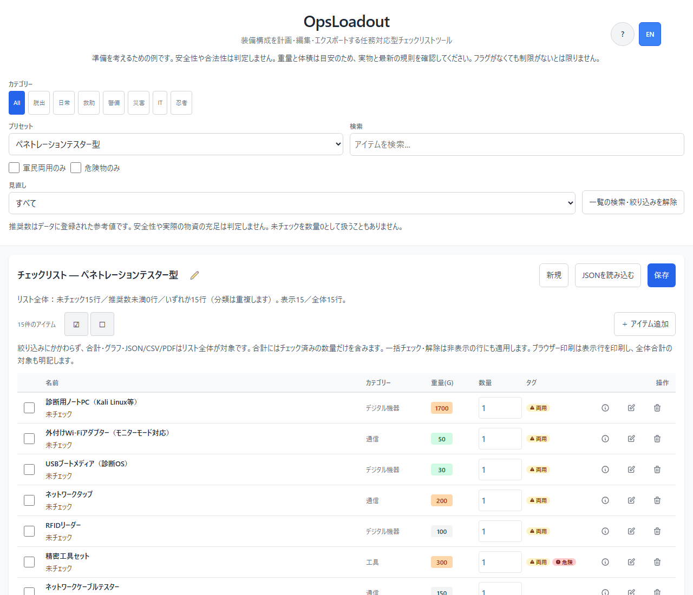
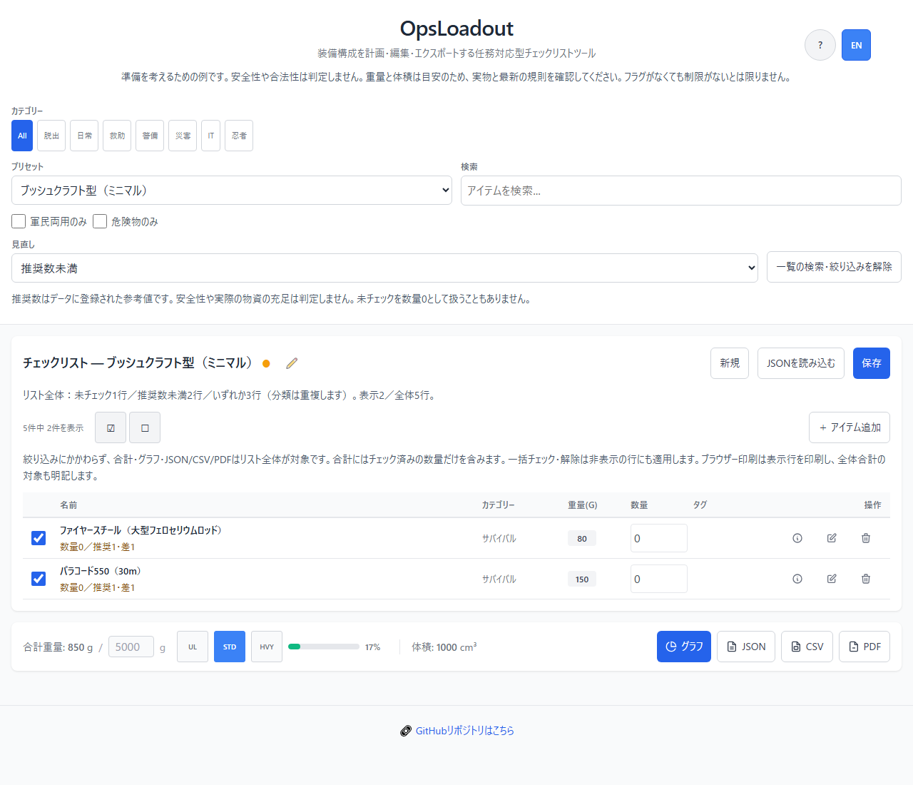
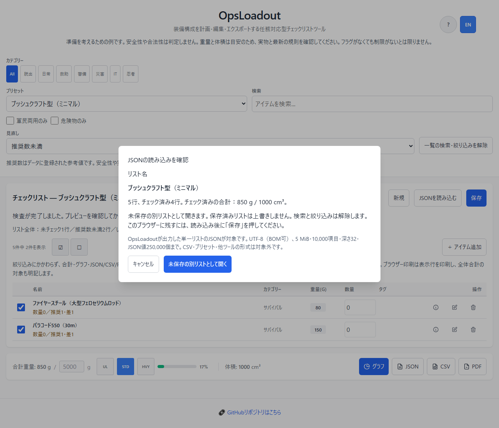

<!--
---
id: day098
slug: ops-loadout

title: "OpsLoadout"

subtitle_ja: "緊急脱出キットのチェックリストツール"
subtitle_en: "Operations Packing Checklist Tool"

description_ja: "装備構成（Loadout）を計画・編集・確認・出力するチェックリストツール。数量とチェック状態から重量・体積を集計し、軍民両用・危険物フラグ、出典、国別の注意を記録します。28種類のプリセットを収録。安全性・合法性や必要物資の充足は判定しません。"
description_en: "A checklist tool for planning, editing, reviewing, and exporting equipment loadouts. Calculates weight and volume from quantities and checked items, and records dual-use/hazard flags, sources, and country-specific notes. Includes 28 presets. Does not determine safety, legality, or whether supplies are sufficient."

category_ja:
  - 物理的セキュリティ
  - サイバー忍術
  - スパイ
  - プレッパー
category_en:
  - Physical Security
  - Cyber Ninjutsu
  - Spy
  - Prepper

difficulty: 3

tags:
  - ops
  - loadout
  - kit-management
  - inventory
  - tactical
  - fieldcraft
  - packlist
  - javascript
  - sere
  - edc
  - disaster-preparedness

repo_url: "https://github.com/ipusiron/ops-loadout"
demo_url: "https://ipusiron.github.io/ops-loadout/"

hub: true
---
-->

# OpsLoadout - 緊急脱出キットのチェックリストツール

[English](README.en.md) · 日本語


[](https://ipusiron.github.io/ops-loadout/)

**Day098 - 生成AIで作るセキュリティツール100**

OpsLoadoutは、任務（Operations）に合わせた装備構成（Loadout）を計画・編集・確認・エクスポートするツールです。

軍・法執行機関、SERE教育、組織内の備蓄／準備運用など、業務・訓練目的での利用を想定しています。
「何を持つか／何をチェックしたか」という現在の状態を管理します。担当者の記録、変更履歴、監査証跡、複数端末の同期は実装していません。

各アイテムにはdual_use（軍民両用）やhazard_flag（危険物）フラグ、出典リンク、国別の法的注意（legality_notes）を紐づけて管理できる仕組みを備えています。
これらは確認のためのメモです。装備の安全性・合法性、避難の可否、必要物資の充足は判定しません。現地の公的な案内、所属組織の手順、製品の使用条件を別途確認してください。

---

## 🌐 デモページ

👉 [https://ipusiron.github.io/ops-loadout/](https://ipusiron.github.io/ops-loadout/)

ブラウザーで直接お試しいただけます。右上のボタンで日本語と英語を切り替えられます。初期言語は保存した設定が英語なら英語、それ以外は日本語です。

---

## 📸 スクリーンショット

>
>
>*ペネトレーションテスター型の一覧。JSON読み込みと見直しの操作欄を表示しています。*

>
>
>*ブッシュクラフト（ミニマル）の入力例。ファイヤースチールとパラコードを数量0、水筒を未チェックにして「推奨数未満」の2件を表示しています。全リストのチェック済み合計は850g・1000cm³です。*

>
>
>*上の状態から出力したJSONの読み込み確認。全5件、チェック済み4件（数量0の2件を含む）、850g・1000cm³を表示します。*

---

## 🎯 主要な設計方針（Design principles）

- 出典を記録：プリセット内の書名・資料名・URLを表示。ただし、記載内容と出典本文の一致や情報の新しさは保証しない
- 教育・準備の補助：持ち物の確認に用い、危険な手順や違法行為の実行手順は扱わない
- 注意事項を区別：`dual_use`（軍民両用）と`hazard_flag`（危険物）に応じた表示と、入力された国別のメモを参照
- 出典情報の限界を明示：28プリセット・398アイテムに出典名を収録。URL付きは7件、URLなしは391件で、全件を出典本文と照合したものではない

---

## 👥 対象ユーザー（Target Users）

本ツールは、以下のような個人・組織での活用を想定しています：

### 企業・組織向け

- 安全管理部門・BCM担当者：海外拠点の駐在員向けキットの一覧化、装備確認
- 警備会社・セキュリティ部門：警備員装備の一覧化、定期点検用リスト
- 消防署・救助隊：消防隊員・救助隊員の携行装備管理、訓練用チェックリスト
- IT企業・セキュリティチーム：ペンテスター、ネットワークエンジニア、フォレンジック調査員の業務用装備管理
- 山岳救助隊・SAR（捜索救助）チーム：救助活動時の装備チェック、ミッション別パッキングリスト
- SERE訓練施設・教育機関：サバイバル訓練カリキュラム、装備教材作成
- 防災担当者（自治体・企業）：職員向け防災キット配布、避難訓練資料

### 個人・家族向け

- 防災意識の高い個人・家族：地震・台風等の災害に備えた緊急避難キット準備
- 複数拠点を持つリモートワーカー：自宅・実家・シェアオフィス等の各拠点に脱出キット配置
- 海外赴任者・海外旅行者：現地での緊急事態に備えたGo Bag（持ち出し袋）準備
- アウトドア愛好家・登山者：日帰り登山・長期トレッキングの装備チェックリスト
- プレッパー（長期備蓄実践者）：自給自足的な長期サバイバル装備の体系的管理

### 専門職・技術者向け

- デジタルノマド・IT技術者：海外移動時の業務継続用装備（PC、通信機器、電源関連）
- ロックスミス（鍵師）：業務用工具の在庫管理、出張時の携行品チェック
- ハードウェア開発者（IoT/組み込み）：現場デバッグ用の測定機器・工具セット管理
- システム管理者（SysAdmin）：データセンター・サーバールーム保守時の工具キット
- 無線通信技術者：電波法遵守を意識した無線機器・測定器具の携行管理

---

## ✨ 主な機能

### 1. プリセット管理

- ビルトインプリセット：28種類のシナリオ別プリセット
  - 脱出・回避系：大使館脱出、SERE
  - 日常携行系：都市個人型
  - 救助・消防系：消防隊携行型、SAR（捜索救助）
  - 警備・防犯系：警備員携行型、鍵師型
  - 災害対応系：災害避難型、プレッパー（長期備蓄）型、ブッシュクラフト（ミニマル/スタンダード/拡張）、マタギ
  - ハッカー・IT系：デジタルノマド型、ペンテスター型、ネットワークエンジニア型、デジタルフォレンジック調査員型、ハードウェア開発者型、SysAdmin型、データリカバリー専門家型、無線通信技術者型
  - サイバー忍者系：ミジンコ流
- 保存済みチェックリスト：作成したリストをブラウザー内に保存して再利用（localStorage）
  - 名前変更：選択中の保存済みリストの名前を編集
  - 削除：不要な保存済みリストを確認して削除
- カテゴリフィルター：脱出/日常/救助/警備/災害/IT/サイバー忍者/旅行・出張/イベント・運営の9カテゴリでプリセットを絞り込み

### 2. チェックリスト管理

- 複数チェックリスト保存：保存済みチェックリスト一覧から読み込み・削除
- 上書き/別名保存：既存チェックリスト編集時に上書きor別名保存を選択可能
- アイテム操作：追加・編集・削除、詳細情報の表示
- 検索・フィルター：表示言語のアイテム名と用途を検索し、軍民両用のみ/危険物のみ/見直し条件と組み合わせ

保存が拒否された場合は未保存の編集を保持し、成功として表示しません。破損した保存データは自動で上書きしません。別タブによる更新は保存直前の比較で検出しますが、同時編集を完全に保証する仕組みではありません。

### 3. パッキング機能

- 数量管理：0〜999の整数を行内で編集。0は0として保持
- 推奨数量：recommended_quantityを参考値として記録し、現在数がそれより少ない行を抽出。実際に必要な量や備えの十分さは判定しない
- 入替頻度：daily / weekly / monthly / never を記録。通知や交換日の計算は行わない
- チェックボックス：パック済みアイテムのチェック管理
- 自動計算：チェック済みアイテムの単位重量・単位体積に数量を掛けて合計。未チェック品は加算しない

### 4. アイテム詳細

- 出典（sources）、法的注意（legality_notes）
- 重量・体積、数量・推奨数量、入替頻度、カテゴリータグ
- 軍民両用フラグ、危険物フラグの警告表示

### 5. エクスポート機能

- PDF：日本語を含む一覧を画像化し、チェック状態・数量・タグ・合計を出力。本文の検索や文字選択はできない
- CSV：UTF-8 BOM付き、CRLF改行、固定12列、全セルを引用。全アイテムを出力し、数式として解釈されやすい先頭文字には対策を適用
- JSON：現在のチェックリスト名、出力時刻、全アイテムを出力。「JSONを読み込む」で確認して読み戻し可能

CSVの列順は`id,name,category,weight_g,volume_cm3,purpose_short,dual_use,hazard_flag,legality_notes,quantity,recommended_quantity,checked`です。数式対策はすべての表計算ソフトでの安全を保証しません。外部由来のデータは、取込時に文字列として扱う設定も確認してください。

JSON・CSV・PDFは絞り込みに関係なく全アイテムを出力します。画面の合計とグラフも全リストのチェック済み数量を対象にします。ブラウザーの印刷だけは表示中の行を印刷し、表示件数と絞り込み条件、全リストから計算した合計であることを併記します。全行を印刷する場合は「一覧の検索・絞り込みを解除」を押してください。

### 6. グラフ表示機能

- 3種類のビュー：円グラフ、レーダーチャート、主要アイテム一覧をタブで切り替え
- 共通統計表示：チェック済みで数量が正のアイテムと、その合計重量・体積を各ビューに表示
- 画像ダウンロード：表示中のグラフをPNG形式でダウンロード可能
- 画像コピー：対応ブラウザーではPNG画像をクリップボードへコピー。利用できない場合はPNG保存を使用

レーダーはデータに付けた0〜5の参考スコアの単純平均です。数量による重み付けはせず、欠損値を除いて計算し、対象がなければ0を表示します。`legality_penalty`も反転せず表示します。生存性・合法性・安全性の実測や認証ではありません。

### 7. 多言語対応（i18n）

- 日本語/英語切り替え：右上の言語ボタンで即座に切り替え
- 設定保存：選択した言語はlocalStorageに保存。保存できない環境では開いているページ内だけで反映
- 表示の切り替え：UIと翻訳付きのプリセット項目を切り替え。利用者が入力した文章やチェックリスト名は自動翻訳しない

プリセットの翻訳付きフィールドを編集した場合、変更した値は両言語に共通の値になります。変更しなかった翻訳や、フォームに表示しないメタデータは保持します。言語切り替えだけで編集中のリストを読み替えることはありません。

### 8. 重量目標プリセット

- UL（ウルトラライト）：重量目標3,000gを設定
- STD（スタンダード）：重量目標5,000gを設定
- HVY（ヘビー）：重量目標10,000gを設定
- 手動設定：100〜1,000,000,000gの整数を設定可能

これらは進捗表示用の目標で、プリセットの実重量や安全に携行できる重量ではありません。ブッシュクラフト3構成の実データの合計は「典型プリセット」の表を参照してください。

### 9. プリセット遅延読込み

- オンデマンド読込み：HTTP(S)では選択時にJSONファイルをfetch
- キャッシュ管理：一度読み込んだプリセットはメモリにキャッシュ
- ローカルファイル対応：`file://`では生成済みの`presets-bundle.js`から読み込み。PDFライブラリーの取得にはネットワークが必要

### 10. JSONバックアップの読み戻し

1. 現在のリストを「JSON」で出力し、保存されたファイルを確認する。
2. 「JSONを読み込む」でファイルを選び、確認画面の名前、全アイテム件数、チェック済み件数、重量と体積を確認する。
3. 「未保存の別リストとして開く」を押す。編集中の変更がある場合は、破棄の確認に同意したときだけ置き換える。
4. 内容を確認して「保存」を押す。新しい保存IDで追加され、同名の保存済みリストも自動では上書きしない。

読み込みだけではlocalStorageへ保存しません。キャンセルや不正なファイルでは現在のリストと保存済みデータを保持します。読み込み待ちの間に編集や別の読み込みを行った場合、古い結果は適用しません。保存できなかった場合も読み込んだ内容を未保存のまま保持します。

受け付けるのは、OpsLoadoutの出力と同じ`checklistName`と`items`を持つ単一のJSONオブジェクトです。次は数量0、未チェック、翻訳、追加メタデータを含む形式の例です。

```json
{
  "checklistName": "Restore example",
  "createdAt": "2026-10-12T00:00:00.000Z",
  "items": [
    {
      "id": "restore_sample",
      "name_ja": "見本",
      "name_en": "Sample",
      "weight_g": 50,
      "volume_cm3": 20,
      "quantity": 0,
      "recommended_quantity": 2,
      "checked": false,
      "packed_by_default": true,
      "custom_meta": {"note": "keep"}
    }
  ]
}
```

明示された0とfalse、変更していない翻訳、アイテムの追加メタデータを保持します。欠けている項目にはデータモデルの既定値を補います。`createdAt`は任意の文字列で、読み込み後の保存日時には引き継ぎません。ルートの追加情報は検査しますが保存リストには取り込みません。プリセットJSON、保存リストの配列、CSV、他DayのJSONは直接読み込めません。

| 検証対象 | 上限 |
|---|---:|
| UTF-8ファイルのバイト数 | 5 MiB（5,242,880バイト） |
| JSONの深さ（ルートを0とする） | 32 |
| JSON内のノード数（ルートと各オブジェクト・配列・値） | 250,000 |
| アイテム数 | 10,000 |

先頭のUTF-8 BOMは1つだけ許可し、BOMもファイルサイズに含めます。不正なUTF-8、構文、型、数値範囲、重複IDに加え、JSON内のどの階層にあっても`__proto__`・`constructor`・`prototype`キーと非有限値を拒否します。深さは末端の値も数え、使わない追加情報も深さとノード数の検査対象です。上限以内でも、保存容量や快適な動作を保証するものではありません。

### 11. 未チェック・推奨数未満の見直し

「見直し」では「すべて」「未チェック」「推奨数未満」「いずれか」を選べます。「いずれか」は未チェックまたは推奨数未満の行です。検索、軍民両用、危険物の条件とはANDで組み合わせます。「一覧の検索・絞り込みを解除」はこれらを解除しますが、上段のプリセットカテゴリは変更しません。

未チェックは`checked === false`、推奨数未満は`quantity < recommended_quantity`です。未チェックでも数量を0とはみなさず、差は`max(0, recommended_quantity - quantity)`で計算します。次の表は判定の例で、trueは該当、falseは非該当です。

| ID | checked | quantity | recommended_quantity | 未チェック | 推奨数未満 | 差 | いずれか |
|---|---|---:|---:|---|---|---:|---|
| A | false | 0 | 0 | true | false | 0 | true |
| B | true | 0 | 2 | false | true | 2 | true |
| C | false | 1 | 3 | true | true | 2 | true |
| D | true | 3 | 3 | false | false | 0 | false |
| E | false | 4 | 3 | true | false | 0 | true |

この5行では未チェック3件、推奨数未満2件、いずれか4件です。両方に該当するCを「いずれか」で二重に数えません。画面の件数は全リストを基準にし、絞り込み後の表示件数も別に示します。行には未チェックや現在数・推奨数との差を表示し、編集や言語切り替えでも更新します。

☑と☐の一括操作は、非表示の行も含む全リストのチェックと解除です。見直しの抽出は入力した参考値との比較であり、安全性・合法性や必要物資の充足の判定ではありません。

---

## 💡 活用シナリオ（Use Cases）

### このツールならではの使い方

以下は入力例であり、実際の運用結果や装備の推奨ではありません。

| 問い | 入力・操作例 | 確認できること |
|---|---|---|
| 授業の実験部品を3班に配ると何gか | 単位重量50g・体積20cm³、数量3をチェック | 合計150g・60cm³。班数を数量に読み替えた集計 |
| 撮影機材の予備を持たないと何g減るか | 50gの予備品を数量3から0へ変更 | その行の寄与が150gから0gへ変化。行は残る |
| 展示用工具の準備済み分だけを数えたい | 50g×3をチェック、100g×2は未チェック | 表には両方を残し、合計は150g。展示の進行管理に利用 |
| 研究・実習キットの根拠を後から確認したい | 品目の出典名・HTTP(S)リンク・注意メモを登録 | 詳細画面で参照元を確認。内容の正しさや履歴は証明しない |
| 家族や部署ごとの構成を分けたい | 同じリストを編集して別名保存、CSVを個別出力 | 記録を別々に保持。リスト間の差分比較や自動同期は行わない |

授業・仕事・暮らし・趣味の持ち物整理に利用できます。以下の3つのシナリオも操作の例であり、避難手順、必要物資、法令への適合を定めるものではありません。

### シナリオ1：海外駐在員の緊急脱出準備（企業・組織向け）

登場人物: 田中さん（外資系企業の安全管理部門・海外拠点担当）

状況:

- 中東地域に10名の駐在員を派遣
- 政情不安により緊急退避（NEO: Noncombatant Evacuation Operation）の可能性
- 各駐在員に標準化された脱出キットを配布する必要がある

OpsLoadoutの活用フロー:

1. 初期準備（Day 1-3）:
   - 「Embassy-Escape型」プリセットをベースに読み込み
   - 現地事情に合わせてカスタマイズ：
     - 現地通貨（米ドル+現地通貨）を追加
     - 大使館連絡先リストを更新
     - 現地SIMカードと充電器を追加
   - 「保存」→「中東駐在員標準キット」と命名して保存

2. 配布・監査（Week 1-2）:
   - 保存済みリストをPDFエクスポート → 駐在員10名に配布
   - 各駐在員が自宅・オフィス・ホテルの3箇所に同じキットを配置
   - 月次の装備監査：PDF印刷版を持って実際にチェック

3. 定期更新（Quarterly）:
   - 四半期ごとにプリセットを見直し：
     - モバイルバッテリーの充電確認
     - 現地で使える通貨・支払い手段の確認
     - 緊急連絡先の更新
   - 元の記録も残す場合は別名保存し、「中東駐在員標準キット・四半期見直し」などと区別。名前変更だけでは変更履歴は残らない

4. 緊急時対応:
   - 移動先・移動時期は公的機関と所属組織の指示で判断。ツールは避難先を指示しない
   - 事前に配布したPDFチェックリストで持ち物確認
   - 帰国後、JSONエクスポートで装備使用状況を記録・次回改善に活用

効果:

- 装備一覧を配布し、準備状況の確認を補助
- PDF/CSVに現在の記録を出力。監査証跡や準備完了の証明にはならない
- 保存済みリストを次回の準備に再利用

---

### シナリオ2：警備会社の装備監査（組織向け）

登場人物: 佐藤さん（警備会社の装備管理責任者）

状況:

- 50名の警備員が各現場（オフィスビル・商業施設・イベント会場）で勤務
- 警備業法に基づく装備基準の遵守が必要
- 装備の紛失・不足を防ぎ、定期点検を実施したい

OpsLoadoutの活用フロー:

1. 標準装備の定義（Month 1）:
   - 「Security Guard型」プリセットを読み込み
   - 自社の装備基準に合わせて編集：
     - 業務用無線機（型番指定）
     - 警備用懐中電灯（型番指定）
     - 装備ごとの確認事項を説明欄へ記録。許可番号の専用欄はなく、機密情報は入力しない
   - 「保存」→「A社標準警備装備v1.0」として保存

2. 現場別カスタマイズ:
   - オフィスビル警備: A社標準 + 「鍵管理簿」
   - イベント警備: A社標準 + 「拡声器」「救急セット（大型）」
   - 夜間警備: A社標準 + 「予備バッテリー×2」
   - それぞれを保存済みチェックリストとして保存

3. 定期監査（Monthly）:
   - 月初に各現場責任者にPDF配布
   - 警備員が実際に装備をチェック
   - 「見直し」の「いずれか」で未チェックまたは推奨数未満の行を抽出し、実物と必要量を確認。CSVは全品を出力するため、購買部へ渡す品は表計算ソフトでも`checked`と数量を確認して選ぶ

4. 新人研修:
   - 新人警備員に「A社標準警備装備v1.0」のPDFを配布
   - OpsLoadoutの画面を見せながら各装備の目的・使用方法を説明
   - 研修後、実際にチェックリストを使って装備確認の実地訓練

効果:

- 装備基準の確認資料を共有。法令遵守の判断は別途必要
- ✅ CSVエクスポートで発注業務の効率化
- ✅ 新人教育資料として活用

---

### シナリオ3：在宅勤務者の複数拠点防災準備（個人・家族向け）

登場人物: 鈴木さん（IT企業勤務・在宅勤務中心・家族3人）

状況:

- 自宅（東京）、実家（静岡）、シェアオフィス（渋谷）の3拠点を行き来
- 首都直下地震への備えとして、各拠点に脱出キットを配置したい
- 家族（配偶者、小学生の子供1人）も含めた準備が必要

OpsLoadoutの活用フロー:

1. 拠点別キットの作成（Week 1）:

   自宅用キット（「Urban-Personal型」ベース）:
   - 大人用×2（自分+配偶者）
   - 子供用×1（小学生向けに軽量化）
   - ペット用×1（猫用のフードと折りたたみ皿）
   - 「保存」→「鈴木家・自宅用」として保存

   車載キット（「Embassy-Escape型」ベース）:
   - 帰宅困難時を想定
   - 工具セット、発煙筒、ブランケット追加
   - 「保存」→「鈴木家・車載用」

   実家用キット（「Disaster型」ベース）:
   - 高齢の両親向けに必要な品を本人や専門家と確認
   - 薬の準備方法・量は医師や薬剤師へ確認し、必要な準備項目だけを記録
   - 「保存」→「鈴木家・実家用」

2. 初回調達（Week 2-3）:
   - 3つのプリセットをCSVエクスポート
   - スプレッドシートで統合 → 重複アイテムをまとめて購入
   - 購入先や予算は利用者が別途比較。価格計算や発注機能はない

3. 物理的配置（Week 4）:
   - 自宅: 玄関の専用バッグに全員分を収納
   - 車: トランクの専用ボックスに収納
   - 実家: 帰省時に持参して両親に説明・配置

4. 定期メンテナンス:
   - 3ヶ月ごと（季節の変わり目）:
     - モバイルバッテリーの充電確認
     - 夏→冬: カイロ追加、冷却シート削除
   - 半年ごと:
     - 全キットを実際に持ち出し訓練
     - OpsLoadoutのチェックリストをPDF印刷して家族で確認
   - 年1回:
     - 装備の見直し: 新製品への更新検討
     - 見直したリストを「鈴木家・自宅用・年次見直し」として別名保存

5. 緊急時の活用:
   - 災害時の行動は自治体などの案内に従って判断
   - 事前に決めた場所で持ち物を確認
   - スマホを使えない場合に備え、PDFの印刷版を別に保管

効果:

- ✅ 3拠点それぞれに最適化された装備配置
- ✅ CSV統合で予算管理・重複購入の防止
- ✅ 家族全員が装備内容を理解・共有

---

## 📦 典型プリセット（Example presets）

以下は収録データの内容です。記載された出典や日数はプリセットの説明であり、公的な装備基準や、全員に十分な構成を示すものではありません。

### 脱出・回避系（Evasion/Escape）

- Embassy-Escape（大使館脱出型）
  緊急現金・携帯水浄化・LED／ライトスティック・ミニファーストエイド・予備SIM 等。
  出典欄には大使館非常計画などの資料名を収録。記載内容が実際の計画の必須要素に一致するかは未検証。

- SERE-Aircrew（SERE航空兵型）
  サバイバルブランケット、信号ミラー、携帯浄水タブレット、コンパス、防水マッチ等。
  出典：米空軍 SERE ハンドブック（AF Handbook 10-644）。

### 日常携行系（EDC/Personal）

- Urban-Personal（都市個人型）
  少額緊急現金、モバイルバッテリー、小型包帯セット、折りたたみ水筒、マスク等。
  日常携行を想定した入力例。所持・使用の条件は利用者が別途確認。

### 救助・消防系（Rescue/Fire）

- Firefighter（消防隊携行型）
  業務用無線機、防爆ライト、耐熱手袋、消防斧、救助ロープ、携帯水筒等。
  出典：消防装備基準、消防技術基準。

- SAR（捜索救助型）
  GPS端末、業務用無線機、大型救急セット、折りたたみ担架、ザイル・カラビナセット等。
  出典：山岳救助マニュアル、救助活動基準。

### 警備・防犯系（Security）

- Security Guard（警備員携行型）
  業務用無線機、警備用懐中電灯、警棒、警笛、巡回記録帳、救急セット等。
  出典：警備業法、警備実務マニュアル。

- Locksmith（鍵師型）
  業務用工具セット、特殊開錠用具（業務用途のみ）、鍵複製機材、ピンニングキット等。
  出典：特殊開錠用具所持禁止法、鍵師業務マニュアル。

### 災害対応系（Disaster）

- Disaster（災害避難型・1人分・1日）
  飲料水（2L）、非常食（アルファ米3食）、懐中電灯、ラジオ、救急セット、現金等。
  出典：内閣府防災情報、東京都防災ホームページ、消防庁防災マニュアル。

- Prepper（プレッパー・長期備蓄型）
  携帯浄水器（長期使用型）、長期保存食（30日分）、サバイバルナイフ、ポータブルソーラーパネル、大容量バッテリーバンク、総合工具セット、釣り具・罠キット、種子セット等。
  出典：長期サバイバル準備ガイド、自給自足型備蓄マニュアル。

- Bushcraft（ブッシュクラフト・3段階）
  - ミニマル：バトニングナイフ、ファイヤースチール、タープ、パラコード、水筒
  - スタンダード：上記に折りたたみノコギリ、ステンレスポット、ウールブランケット、救急キット等を追加
  - 拡張：小型ハチェット、ハンモック、カービングナイフ、衛星通信機等を含む構成
  出典：ブッシュクラフト入門書籍、北欧アウトドア文化資料。

- Matagi（マタギ型・七つ道具）
  ナガサなど、収録資料を基にした持ち物の例。現代の狩猟に必要な許可や安全確認を代替しない。

全行をチェックし、プリセットの数量をそのまま使った集計値は次のとおりです。品物の実測値ではなく、JSON内の重量・体積による計算です。

| プリセットID | 重量（g） | 体積（cm³） | 数量合計 |
|---|---:|---:|---:|
| `bushcraft_minimal` | 1280 | 1730 | 5 |
| `bushcraft_standard` | 4145 | 6800 | 15 |
| `bushcraft_extended` | 8674 | 14590 | 27 |

### ハッカー・IT系（Hacker/IT）

- Digital Nomad（デジタルノマド型）
  ノートPC、マルチポート充電器、VPNルーター、予備SIM、ポータブルSSD、多機能USBアダプター等。

- Pentester（ペンテスター型）
  診断用ノートPC、外付けWi-Fiアダプター、USBブートメディア、ネットワークタップ、RFIDリーダー等。

- Network Engineer（ネットワークエンジニア型）
  LANケーブルテスター、トーンジェネレーター、圧着工具セット、光ファイバーテスター等。

- Digital Forensics（デジタルフォレンジック調査員型）
  書き込み防止装置（Write Blocker）、ディスクイメージング装置、証拠保全バッグ、ハッシュ値計算ツール等。

- Hardware Developer（ハードウェア開発者・IoT型）
  ポータブルオシロスコープ、ロジックアナライザー、JTAG/SWDデバッガー、はんだごてセット等。

- SysAdmin（システム管理者型）
  シリアルコンソールケーブル、ポータブルKVMスイッチ、ブート用USBメディア、ポータブルバックアップドライブ等。

- Data Recovery（データリカバリー専門家型）
  各種インターフェイスアダプター、ディスククローニングドック、ディスク診断ツールセット、データ復旧ソフトウェアUSB等。

- RF Tech（無線通信技術者型）
  SDRドングル、スペクトラムアナライザー、アンテナセット、周波数カウンター、各種同軸ケーブル、同軸ケーブル加工工具等。

### サイバー忍者系（Cyber Ninja）

- Daphnia Style（ミジンコ流）
  軽装・多機能・ローキーを重視した装備セット。都市偵察・暗部探索・汎用作業向け。
  耐衝撃USBメモリ、耐水ノート、赤外線ライト、暗視スコープ、タクティカルペン、ファラデーバッグ、ノートPC、マルチツール、小型録音デバイス等。
  出典：ミジンコ流サイバー忍者装備リスト。

> 注意：特殊工具などのフラグや国別メモはデータに記録された注意事項です。警告がないことは、所持・使用が適法または安全であることを意味しません。出典の記載も内容の正確さを保証しません。

---

## 🗂️ データモデル（JSON スキーマ）

### プリセットファイル構造

```json
{
  "category": "disaster",
  "name_ja": "ブッシュクラフト型（ミニマル）",
  "name_en": "Bushcraft Minimal",
  "items": []
}
```

`items`には次節のようなアイテムを並べます。上の例は構造を示すため空配列にしています。

### アイテムスキーマ（多言語対応）

```json
{
  "id": "bc_batoning_knife",
  "weight_g": 350,
  "volume_cm3": 200,
  "quantity": 1,
  "recommended_quantity": 1,
  "packed_by_default": false,
  "category_tags": ["tools", "bushcraft"],
  "repack_frequency": "never",
  "dual_use": true,
  "hazard_flag": true,
  "concealability": "low",

  "name_ja": "バトニングナイフ（フルタング・厚刃）",
  "name_en": "Batoning Knife (Full Tang, Thick Blade)",
  "category_ja": "工具",
  "category_en": "Tools",
  "purpose_short_ja": "薪割り・木材加工・シェルター構築",
  "purpose_short_en": "Wood splitting, carving, shelter building",
  "description_ja": "バトニング（薪割り）に適した厚刃のフルタングナイフ。",
  "description_en": "Full-tang thick blade knife suitable for batoning.",
  "legality_notes_ja": {
    "JP": "所持・携行・使用の条件を現地の公的情報で確認",
    "US": "適用される地域の規則を確認"
  },
  "legality_notes_en": {
    "JP": "Check official local information on possession, carrying, and use",
    "US": "Check the rules that apply in the relevant jurisdiction"
  },

  "sources": [{"title": "Bushcraft 101 - Dave Canterbury"}],
  "scores": {
    "survivability": 5,
    "signalability": 0,
    "exfiltration_support": 1,
    "concealability": 1,
    "legality_penalty": 3
  }
}
```

### フィールド説明

#### 基本フィールド

| フィールド | 型 | 説明 |
|:---|:---|:---|
| `id` | string | 一意識別子 |
| `weight_g` | number | 単位重量（g）。0〜1,000,000,000の有限値 |
| `volume_cm3` | number | 単位体積（cm³）。0〜1,000,000,000の有限値 |
| `dual_use` | boolean | 軍民両用フラグ |
| `hazard_flag` | boolean | 危険物フラグ |

#### 多言語フィールド（`_ja` / `_en` サフィックス）

| フィールド | 説明 |
|:---|:---|
| `name_ja` / `name_en` | アイテム名 |
| `category_ja` / `category_en` | カテゴリー名 |
| `purpose_short_ja` / `purpose_short_en` | 用途（簡潔） |
| `description_ja` / `description_en` | 詳細説明 |
| `legality_notes_ja` / `legality_notes_en` | 国別法的注意事項 |

#### パッキングフィールド

| フィールド | 型 | デフォルト | 説明 |
|:---|:---|:---|:---|
| `quantity` | number | 1 | 現在の数量。0〜999の整数 |
| `recommended_quantity` | number | 1 | 参考の推奨数量。0〜999の整数 |
| `packed_by_default` | boolean | false | デフォルトでパック済み |
| `checked` | boolean | `packed_by_default`またはfalse | 現在のチェック状態。明示された値を優先 |
| `category_tags` | array | [] | カテゴリタグ配列 |
| `repack_frequency` | string | "never" | 入替頻度（daily/weekly/monthly/never） |

`loadout-core.js`が型、有限値、範囲、ID重複を検証します。文字列の数量や不正な負数は受け入れません。1リスト10,000件、保存リスト1,000件までを検証上の上限とし、ブラウザーの保存容量や快適に操作できる件数を保証するものではありません。

`scores`の各値は0〜5の参考値です。レーダーの5軸は`survivability`、`signalability`、`exfiltration_support`、`concealability`、`legality_penalty`で、未検証の評価値として扱います。フォームにないフィールドも編集・保存時に保持します。

---

## 🔗 関連ツールとの連携

### 防災備蓄管理ツール（RollingStock Planner）との使い分け

OpsLoadoutと[防災備蓄管理ツール](https://ipusiron.github.io/rollingstock-planner/)は、災害対応における異なる段階と目的をカバーする相補的なツールです。

#### 📦 RollingStock Planner（備蓄管理）

用途: 自宅・拠点での長期滞在型備蓄（在宅避難）

- 対象: 食料・水・医療品・ペット用品の在庫管理
- 時間軸: 3・7・14・30・180日の計画値。生存できる期間の保証ではない
- 管理方式: ローリングストック原則（定期的な消費と交換で鮮度維持）
- 機能:
  - 家族ごとの計画値と水量・人用食料のカロリーを別々に集計
  - 期限の日付と種類（賞味期限・消費期限・使用期限など）を記録
  - 数量の消費・補充、期限や入力不足による見直しフィルター
  - 防災学習コンテンツ、JSONの出力・読み込み
- 保管場所: 自宅・オフィスの備蓄スペース（パントリー、物置、倉庫）
- 重量制約: 携行重量は集計しない。保管場所の耐荷重・温度・湿度などは別途確認

#### 🎒 OpsLoadout（緊急脱出キット）

用途: 緊急避難時の携行装備（避難脱出）

- 対象: 軽量・コンパクトな脱出用装備
- 時間軸: 利用者が想定する持ち出し場面。何時間分の必需品が揃うかは判定しない
- 管理方式: チェックリスト（パッキング確認・装備監査・定期入替）
- 機能:
  - シナリオ別プリセット（都市型/SERE/大使館脱出/災害）
  - 法的注意・dual_useフラグ管理
  - 重量・体積の自動計算
  - エクスポート機能（PDF/CSV/JSON）
  - JSONバックアップの読み戻し、未チェック・推奨数未満の抽出
- 保管場所: すぐに持ち出せる場所（玄関・車内・オフィスデスク下・枕元）
- 重量制約: 入力した重量目標と合計を比較。個人に適した携行可能重量は判定しない

### 効果的な使い分け戦略

#### 1. 階層的な防災体制

```
【レベル1】緊急脱出キット（OpsLoadout）
  ↓ すぐに持ち出せる最小限の装備
【レベル2】在宅避難用備蓄（RollingStock）
  ↓ 自宅・拠点に滞在する場合の長期備蓄
【レベル3】拠点間移動・補給
  ↓ 状況に応じた装備の再編成
```

#### 2. 統合的な準備アプローチ

備蓄と携行の二層構造:

| アイテムカテゴリ | RollingStockで管理（備蓄） | OpsLoadoutで管理（携行） |
|---|---|---|
| 水 | 容量・本数・期限を登録した飲料水 | 携行する水と容器。浄水用品は製品条件も確認 |
| 食料 | アルファ米、缶詰、レトルト等の在庫・カロリー | 持ち出す食品の重量・数量 |
| 医療 | 専門家と相談した備えの記録、救急箱 | 携帯救急セット。薬の量・管理は医師や薬剤師に確認 |
| 照明 | ランタン、懐中電灯（据置型） | ヘッドランプ、ケミカルライト |
| 通信 | 手回しラジオ、単1電池×20 | モバイルバッテリー、予備SIM |
| ペット | ペットフード、猫砂。必要量は商品表示や獣医師の助言を確認 | ペット用携帯水、折りたたみ皿 |
| 衛生 | トイレットペーパー、簡易トイレ×50 | ウェットティッシュ、マスク×10 |

表は管理対象を分ける例です。品物を共有するか、別に用意するかは利用者の計画によります。同じ在庫を両ツールに登録する場合、二重に数えないよう実物との対応を確認してください。

#### 3. データ連携の可能性

両ツールに自動同期機能はありません。どちらも自分の形式のJSONを出力・読み込みできますが、形式が異なるため相互に直接読み込めません。OpsLoadoutはCSVも出力できます。以下は画面や出力ファイルを参照した手作業の例です：

連携パターン1: 備蓄 → 携行への抽出

1. RollingStock Plannerの画面や出力JSONから備蓄品を確認
2. 持ち出す候補の品・数量を別に整理。食品や水を別の品に置き換えても同等の備えになるとは限らない
3. 抽出したリストをOpsLoadoutに手動入力し、緊急脱出キット化

連携パターン2: 総合管理スプレッドシート
```
マスター備蓄台帳.xlsx
├─ シート1: RollingStock管理品（据え置き備蓄）
├─ シート2: OpsLoadout管理品（携行装備）
└─ シート3: 購入リスト（両方の不足品を統合）
```
RollingStockの記録を転記し、OpsLoadoutのCSVと合わせて確認できます。列の変換や照合は利用者が行います：

- 同じ品物を二重に購入していないか確認
- 価格を手入力して予算を管理（ツール内の価格計算ではない）
- 別の予定表に点検日を記録（ツールからの通知ではない）

連携パターン3: 定期棚卸しサイクル

- 春（4月）: RollingStockの期限・保管状態を確認 → 必要な補充 → OpsLoadoutへの影響確認
- 夏（7月）: OpsLoadoutのキットを実物と照合 → 品物を移した場合は元の在庫も手動更新
- 秋（10月）: 両ツールのデータをJSONで外部保存し、それぞれのツールで読み込みを確認。OpsLoadoutでは未保存の別リストとして確認してから保存
- 冬（1月）: 年間レビュー → 新製品への更新検討

#### 4. 推奨される運用フロー

初期セットアップ（1回目）:

1. RollingStock Planner: 家族構成と想定日数、1人・1匹あたりの計画値を設定。表示される不足量は入力値との比較であり、必要量の診断ではない
2. OpsLoadout: 避難シナリオ（都市型/災害/プレッパー）を選び、家族分のキットを作成（大人用×2、子供用×2など）
3. 物理的配置:
   - 備蓄品 → パントリー・物置に整理
   - 脱出キット → 玄関・寝室・車トランクに分散配置
4. 初回調達: 両ツールの記録を確認し、OpsLoadoutのCSVなどを使って購入リストを別に作成

定期メンテナンス（ローリングストック運用）:

| 頻度 | RollingStock Planner | OpsLoadout |
|---|---|---|
| 毎月 | 期限・種類・保存状態を確認。期限切れ品や医薬品を消費候補とみなさず、商品表示や専門家の指示を確認 | ― |
| 3ヶ月ごと | 季節や保管条件に合わせて備蓄を見直し | 製品表示に従ってバッテリー類を確認 |
| 半年ごと | ペットフードのローテーション、医薬品の期限確認 | 全アイテムのパッキング確認（実際に持ち出し訓練） |
| 年1回 | 備蓄計画の全面見直し（家族構成変更、ペット増減） | 装備の陳腐化チェック（新製品への更新検討） |

緊急時の使い分け判断:

```
地震発生
  ↓
自治体などの避難情報と現在の状況を確認
  ├─ 拠点に留まる計画 → RollingStockの記録を参照
  └─ 移動する計画 → OpsLoadoutの記録を参照
      （移動の可否・行先・安全性は両ツールでは判断しない）
```

### 実用例：家族4人＋ペット1匹の災害対応準備

家族構成: 大人2名、小学生2名、猫1匹

以下は管理項目と計算の例です。日数・人数だけでは十分な備えかどうかは判断できません。水量の式は人用だけで、猫や生活用水は含みません。

#### RollingStock Plannerで管理（在宅避難用・7日を想定）:

- 飲料水: 2L×42本 = 84L（計算例として1人3L/日×4人×7日 = 84L）
- 食料:
  - アルファ米×28食（在庫例。4人の7日分の3食を揃えたという意味ではない）
  - 缶詰×20缶（副菜・タンパク質）
  - レトルトカレー×15袋
  - 栄養補助食品×10箱
- ペット用品:
  - ドライフード2kg（在庫例。何日分になるかは別途確認）
  - ウェットフード×14缶
  - 猫砂5L×2袋
  - ペットシーツ×50枚
- 医療: 医師や薬剤師に相談した薬の備え、救急箱、体温計などを記録
- 衛生: 簡易トイレ×50回分、トイレットペーパー×12ロール、生理用品
- エネルギー: カセットコンロ、ガスボンベ×9本
- 重量・保管条件: この一覧全体の重量は未集計。水84Lだけでも水自体は約84kgとなるため、容器や他の品を含めた荷重・置き場所を別途確認

#### OpsLoadoutで管理（持ち出す品の入力例）:

- 大人用キット×2（Urban-Personal改）:
  - 携帯浄水器、エナジーバー×6、救急セット（小）、モバイルバッテリー、現金3万円、予備SIM、ヘッドランプ、レインコート
  - 計算用の仮定: 1キット2.5kg。列挙した品の実測合計ではなく、実際は各品の重量・体積を入力
- 子供用キット×2（簡易版）:
  - 水500ml×2、お菓子、絆創膏セット、ホイッスル、IDカード
  - 計算用の仮定: 1キット1.2kg。水だけで1Lとなるため、容器と他の品を含む体積を別途確認
- ペット用キット×1:
  - ペットフード、折りたたみ皿、リード予備、必要な記録
  - 計算用の仮定: 0.8kg。必要な量・体積は別途確認
- 車載キット×1（Embassy-Escape型、車トランク常備）:
  - 上記に加え工具セット、ブランケット、発煙筒、牽引ロープ
  - 計算用の仮定: 4kg。車内の保管条件や製品の取扱いも確認
- 計算例の合計: 2.5×2 + 1.2×2 + 0.8 = 8.2kg（車載4kgを除く）。誰がどれだけ運べるか、安全に携行できるかは判定しない

#### 配置戦略:

- 玄関: 大人用×2、子供用×2、ペット用×1（すぐ持ち出せるよう専用バッグに）
- 寝室: 簡易版キット（夜間地震用）
- 車: 車載キット（帰宅困難時・勤務先被災時用）
- パントリー: RollingStockの備蓄（期限管理表を扉に貼付）

備蓄と持ち出す品を分けて記録できますが、この例だけで7日間や72時間の生活を維持できるとは判断できません。実際の条件に応じて計画を見直してください。

---

## 🔒 セキュリティ対策

このツールはGitHub Pagesで公開されており、以下のセキュリティ対策を実装しています：

### クライアントサイドセキュリティ

- ✅ XSS対策: HTMLへの出力時に文字列をエスケープ。出典リンクはHTTP(S)だけを許可し、資格情報・空白・制御文字を含むURLを拒否
- ✅ SRI（完全性チェック）: CDNスクリプトに整合性ハッシュを適用
- ✅ 入力と保存の検証: JSONの型・数値範囲・ID重複を検証し、保存失敗や競合を表示
- ✅ CSP: ローカルスクリプトと指定したCDNに制限。`unsafe-eval`は使用しない
- ⚠️ セキュリティヘッダー: GitHub Pagesの制約によりHTTPヘッダーの設定不可（カスタムサーバーでは推奨）

### データプライバシー

- 🔒 ブラウザー内の処理: 未保存データはメモリー内、保存データはlocalStorage。装備データをアプリからサーバーへ送る処理はない
- 🔒 アナリティクス不使用: Google Analyticsなどのトラッキングなし
- 🔒 Cookie不使用: アプリ自身はCookieを設定しない
- ⚠️ 通信の範囲: 公開ページやCDNスクリプトの取得は通信を伴う。出典リンクを開く場合や、出力ファイル・クリップボードの内容を共有する場合も別扱い

保存データと出力ファイルは暗号化しません。同じ端末・ブラウザーを使う人や、同一オリジンのスクリプトから読まれ得るため、個人情報・機密情報・実際の作戦情報は入力しないでください。ブラウザーのデータ消去で保存内容を失うことがあります。JSONを外部保存し、「JSONを読み込む」で内容を確認して読み戻せます。読み込みは端末内で処理し、保存済みリストを自動で上書きしません。

詳細は [docs/SECURITY.md](docs/SECURITY.md) を参照してください。

---

## 📁 ディレクトリー構成

```
ops-loadout/            # プロジェクトルート
├── .github/            # GitHub用の設定
│   └── workflows/      # CIの定義
│       └── test.yml    # pushとPRでNodeテストを実行
├── index.html          # メインHTML（UI構造、meta CSP）
├── app.js              # アプリケーションロジック（遅延読込み対応）
├── i18n.js             # 多言語対応（日本語/英語切り替え）
├── loadout-core.js     # データ検証・JSON復元・見直し・編集・集計・CSV
├── loadout-store.js    # 保存領域の読書きと競合検出
├── presets-bundle.js   # file://用の生成済みプリセット
├── css/                # モジュール化されたスタイルシート
│   ├── main.css        # エントリポイント（@import）
│   ├── utilities.css   # ローカルの基本ユーティリティー
│   ├── accessibility.css # 小画面・フォーカス・入力の補助
│   ├── base.css        # 基本スタイル
│   ├── layout.css      # レイアウト
│   ├── controls.css    # コントロール部品
│   ├── buttons.css     # ボタン
│   ├── forms.css       # フォーム
│   ├── badges.css      # バッジ（dual_use/hazard）
│   ├── modals.css      # モーダル・グラフ表示
│   ├── table.css       # テーブル
│   ├── filters.css     # フィルター
│   ├── saved.css       # 保存チェックリスト
│   └── print.css       # 印刷用
├── presets/            # プリセットデータ（JSON、遅延読込み）
│   ├── index.json      # プリセット一覧・メタデータ
│   ├── evasion/        # 脱出・回避系
│   │   ├── embassy.json # 大使館脱出型
│   │   └── sere.json  # SERE航空兵型
│   ├── edc/            # 日常携行系
│   │   └── urban.json # 都市個人型
│   ├── rescue/         # 救助・消防系
│   │   ├── firefighter.json # 消防隊携行型
│   │   └── sar.json   # 捜索救助型
│   ├── security/       # 警備・防犯系
│   │   ├── security_guard.json # 警備員携行型
│   │   └── locksmith.json # 鍵師型
│   ├── disaster/       # 災害対応系
│   │   ├── disaster.json # 災害避難型
│   │   ├── prepper.json # 長期備蓄型
│   │   ├── bushcraft_minimal.json # ブッシュクラフト・ミニマル
│   │   ├── bushcraft_standard.json # ブッシュクラフト・標準
│   │   ├── bushcraft_extended.json # ブッシュクラフト・拡張
│   │   └── matagi.json # マタギ型
│   ├── cyber_ninja/    # サイバー忍者系
│   │   └── mijinko.json # ミジンコ流
│   └── hacker/         # ハッカー・IT系
│       ├── hacker.json # デジタルノマド型
│       ├── pentest.json # ペンテスター型
│       ├── neteng.json # ネットワークエンジニア型
│       ├── forensic.json # フォレンジック調査員型
│       ├── hwdev.json # ハードウェア開発者型
│       ├── sysadmin.json # システム管理者型
│       ├── datarecovery.json # データリカバリー型
│       └── rftech.json # 無線通信技術者型
├── scripts/            # 開発用スクリプト
│   └── build-presets.cjs # JSONからバンドルを生成・照合
├── test/               # Nodeの回帰テスト
│   ├── core.test.js    # 検証・編集・集計・保存
│   ├── i18n.test.js    # 辞書と参照キーの対応
│   ├── import.test.js  # JSON読み戻しの検証と境界値
│   ├── review.test.js  # 未チェック・推奨数未満の判定
│   ├── output.test.js  # CSVと集計の出力
│   ├── ui.test.js      # ローカル資産・モーダル・印刷
│   └── readme.test.js  # 日英の見出し・数値・リンク・画像
├── docs/               # ドキュメント
│   ├── DEVELOPMENT.md  # 開発者向け技術詳細
│   └── SECURITY.md     # セキュリティポリシー
├── assets/             # 画像リソース
│   ├── screenshot.png # 日本語・ペンテスター型
│   ├── screenshot2.png # 日本語・ミニマルの見直し
│   ├── screenshot3.png # 日本語・JSON読み込み確認
│   └── en/            # 英語画面の画像
│       ├── screenshot.png # ペンテスター型
│       ├── screenshot2.png # ミニマルの見直し
│       └── screenshot3.png # JSON読み込み確認
├── package.json        # 依存不要のテストコマンド
├── README.md           # プロジェクト説明（本ファイル）
├── README.en.md        # 英語版の説明
├── CLAUDE.md           # 開発ガイド
├── LICENSE             # MITライセンス
├── .gitignore          # Git除外ファイル設定
└── .nojekyll           # GitHub Pages設定
```

### 技術スタック

- フロントエンド: Vanilla JavaScript（フレームワーク不使用）
- スタイリング: リポジトリー内のCSS
- PDF生成: jsPDF 4.2.1 + html2canvas 1.4.1（CDN・SRI付き、描画結果を画像化）
- データ保存: localStorage（ブラウザーローカル）
- ホスティング: GitHub Pages（静的サイト）

### 開発者向け技術詳細

本ツールの実装の詳細、アーキテクチャ、工夫している部分については、[DEVELOPMENT.md](docs/DEVELOPMENT.md)を参照してください。

主な内容:

- 状態管理システム
- 保存済みチェックリストの再利用
- チェックリスト保存ロジック（上書き/別名保存）
- JSON読み戻しの検証と未保存リストへの適用
- 見直し条件、表示行と全リストの集計範囲
- PDFエクスポート実装（html2canvas + jsPDF）
- セキュリティ対策（XSS防止、localStorage検証）
- カテゴリフィルタリング
- パフォーマンス最適化

ローカルでは`index.html`を直接開くか、リポジトリールートで`python -m http.server 8000`を実行して`http://localhost:8000/`を開きます。公開ページを自動でオフライン保存する機能はありません。`file://`の保存領域やクリップボードの利用可否はブラウザーに依存します。

開発用の検査はNode.js 22で`npm test`を実行します。npmパッケージのインストールは不要です。プリセットJSONを変更したときは`node scripts/build-presets.cjs`でバンドルを生成し、`node scripts/build-presets.cjs --check`で一致を確認してください。

---

## 📄 ライセンス

MIT License – 詳細は [LICENSE](LICENSE) を参照してください。

[jsPDF](https://github.com/parallax/jsPDF/blob/v4.2.1/LICENSE)と[html2canvas](https://github.com/niklasvh/html2canvas/blob/v1.4.1/LICENSE)を利用し、それぞれのMITライセンスに従います。

---

## 🛠️ このツールについて

本ツールは、「生成AIで作るセキュリティツール100」プロジェクトの一環として開発されました。
このプロジェクトでは、AIの支援を活用しながら、セキュリティに関連するさまざまなツールを100日間にわたり制作・公開していく取り組みを行っています。

プロジェクトの詳細や他のツールについては、以下のページをご覧ください。

🔗 [https://akademeia.info/?page_id=42163](https://akademeia.info/?page_id=42163)
